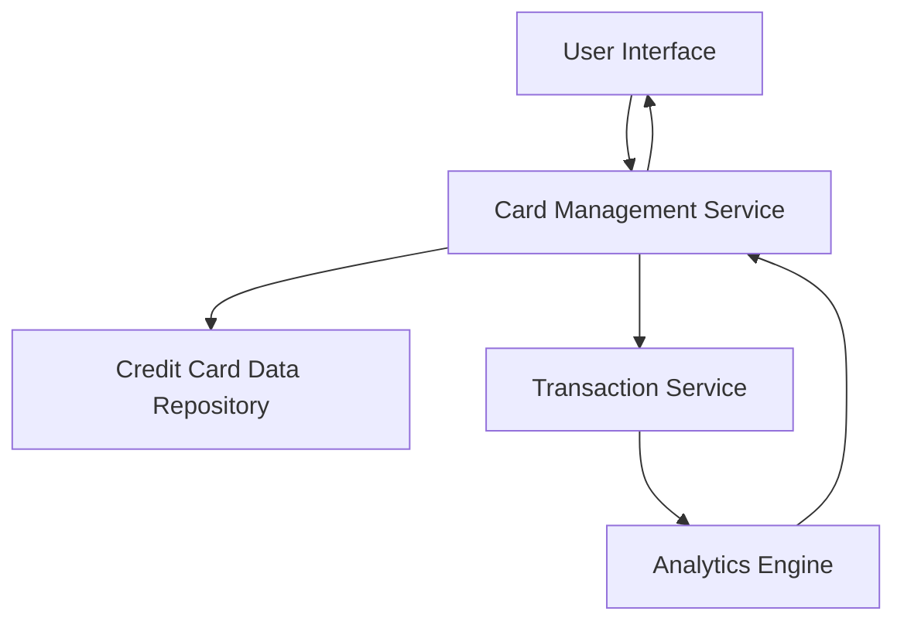

#### 1. High-Level Design

- **Summary:** This epic delivers a multi-card management interface enabling users to view, monitor, and analyze multiple credit cards from a single location. Users can access card-specific details including utilization, limits, spending trends, and perform card selection/filtering operations. The solution provides a consolidated view for optimized credit card usage decisions.

- **Component Flow:**

- **Integration Points:**
  - **Upstream:** Credit Card Data Repository (for card information, balances, limits, and card metadata)
  - **Upstream:** Transaction Service (for card-specific spending data and transaction history)
  - **Downstream:** User Interface layer for rendering card details and analytics

- **Key Assumptions:**
  - Card data is retrieved via RESTful APIs from the credit card data repository with JSON format responses
  - Transaction data is pre-categorized and available in real-time or near-real-time from the transaction service

- **NFR Highlights:** System must support unlimited cards per user with secure encrypted data retrieval; interface must maintain performance with multiple cards loaded simultaneously.

- **Data Flow:** User requests card list → Card Management Service queries Credit Card Data Repository for card metadata (limits, balances, card details) → Service queries Transaction Service for card-specific spending data → Analytics Engine processes spending patterns per card → Aggregated card information with spending insights returned to User Interface → User can filter/select specific cards for detailed view.

#### 2. Validation Report

- **Requirements Coverage:** The design fully covers the epic's scope including multiple credit card display, card-wise spend analysis, individual card details view, credit limit tracking, and card selection/filtering. The architecture supports secure encrypted retrieval and performance requirements for multiple cards. All stated NFRs (unlimited cards support, security, performance) are addressed through the component design. Integration dependencies with credit card data repository and transaction service are explicitly mapped in the architecture.