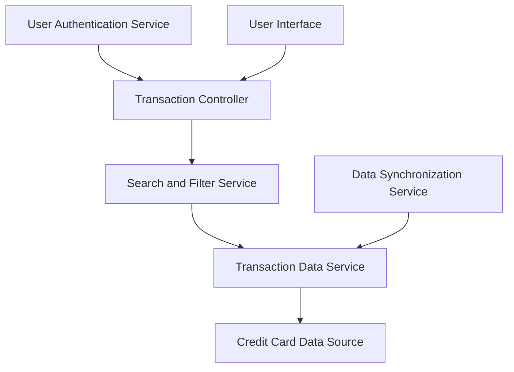

#### 1. High-Level Design

- **Summary:** This epic delivers a comprehensive transaction management interface that enables users to view, search, filter, and analyze their credit card transactions across all cards in their portfolio. The system provides detailed transaction histories with drill-down capabilities, supporting various filtering parameters to help users track spending activities, verify charges, and maintain financial awareness through a unified, responsive interface.

- **Component Flow:**

- **Integration Points:**
  - **Upstream:** Transaction data service (provides transaction records and details), Credit card data source (provides card information for transaction context), User authentication service (validates user access to specific cards)
  - **Downstream:** Data synchronization service (ensures transaction data freshness)
  - **Internal:** Search and Filter Service (processes user queries and applies filtering logic)

- **Key Assumptions:**
  - Transaction data is synchronized periodically from source systems; real-time transaction posting is not required
  - Pagination is implemented with default page size of 25-50 transactions to balance performance and usability

- **NFR Highlights:** Transaction list must load within 3 seconds; support pagination for large transaction volumes; handle transaction data refresh efficiently; responsive design for transaction viewing across devices

- **Data Flow:** User authenticates and navigates to transaction view → Transaction Controller retrieves user's card portfolio from User Authentication Service → User applies search/filter criteria (date range, amount, merchant, category, card) → Search and Filter Service constructs query with pagination parameters → Transaction Data Service queries Credit Card Data Source for matching transactions → Data Synchronization Service ensures latest transaction data is available → Paginated transaction list is returned with summary metadata (total count, filtered count) → User Interface displays transactions in tabular or card format → User selects a transaction to view details → Transaction Controller retrieves full transaction details including merchant info, category, card used, amount, date, status → Detail view is rendered in User Interface → User can navigate through pages or modify filters to refine results

#### 2. Validation Report

- **Requirements Coverage:** The design fully satisfies the epic's scope including transaction listing and display, transaction detail view, multi-card transaction aggregation, transaction search and filtering, transaction history access, and responsive transaction interface. All NFR requirements are addressed: 3-second load time through pagination and efficient querying, pagination support for large volumes, efficient data refresh through the synchronization service, and responsive design for cross-device viewing. All specified dependencies (transaction data service, credit card data source, user authentication service, data synchronization service) are incorporated into the architecture and data flow.