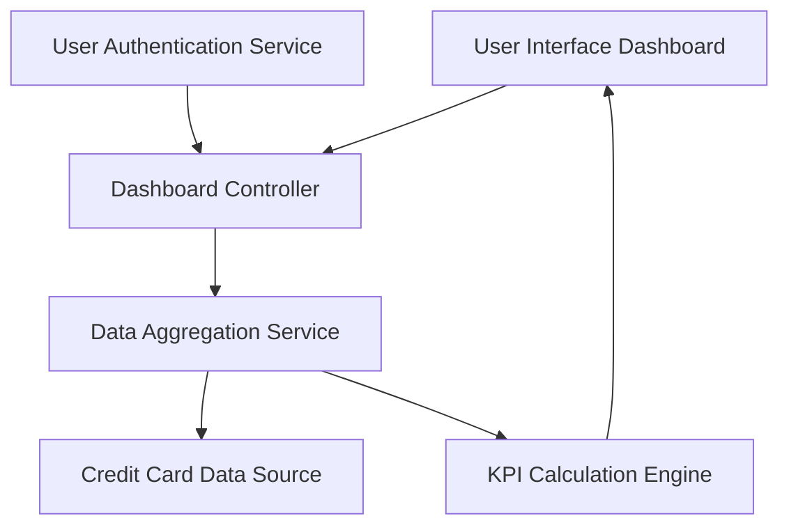

#### 1. High-Level Design

- **Summary:** This epic implements a consolidated dashboard that provides users with real-time visibility into their credit card portfolio health through key performance indicators. The dashboard aggregates data from multiple credit cards to display monthly spending, total credit limits, available credit, and outstanding amounts, enabling users to quickly assess their overall credit utilization and financial position.

- **Component Flow:**

- **Integration Points:**
  - **Upstream:** Credit card data source system (provides card balances, limits, and transaction summaries), User authentication service (validates user identity and retrieves user-specific card portfolio)
  - **Downstream:** Data aggregation service (consolidates multi-card calculations)
  - **Internal:** KPI Calculation Engine (computes derived metrics like credit utilization, available credit)

- **Key Assumptions:**
  - Real-time data refresh implies polling or event-driven updates from the credit card data source at defined intervals (e.g., every 5 minutes)
  - Credit utilization is calculated as (Outstanding Amount / Total Credit Limit) × 100

- **NFR Highlights:** Dashboard must load within 2 seconds; support responsive design across desktop and mobile devices; real-time data refresh capability for KPI metrics; support concurrent users viewing individual dashboards

- **Data Flow:** User authenticates → User Authentication Service validates credentials and retrieves user profile → Dashboard Controller requests user's credit card portfolio → Data Aggregation Service queries Credit Card Data Source for all cards associated with the user → Raw data (balances, limits, outstanding amounts, monthly spending) is retrieved → KPI Calculation Engine computes aggregated metrics (total credit limit, total available credit, total outstanding, overall utilization) → Calculated KPIs are formatted and sent to User Interface Dashboard → Dashboard displays consolidated view with individual card details and portfolio-level summaries → Real-time refresh mechanism periodically updates KPIs without full page reload

#### 2. Validation Report

- **Requirements Coverage:** The design comprehensively addresses all scope elements including dashboard KPI display, monthly spend tracking, total credit limit aggregation, available credit calculation, outstanding amount display, multiple credit card management, consolidated card view, and responsive layout design. The architecture supports all NFR requirements: 2-second load time through efficient data aggregation, responsive design across devices, real-time data refresh capability, and concurrent user support through stateless service design. All specified dependencies (credit card data source, user authentication service, data aggregation service) are integrated into the component flow.