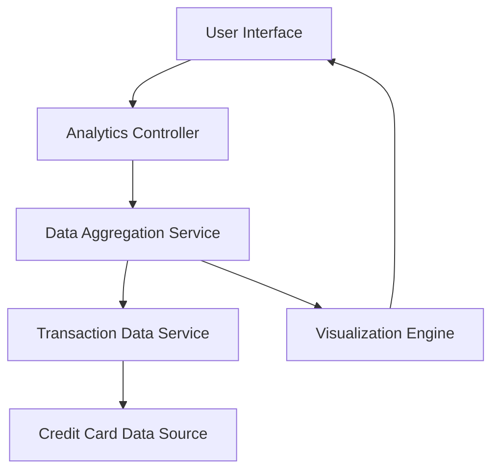

#### 1. High-Level Design

- **Summary:** This epic delivers a comprehensive spending analytics module that enables users to visualize and analyze their credit card spending patterns across multiple dimensions. The system aggregates transaction data to provide category-wise breakdowns (Food & Dining, Fuel, Shopping, Travel, Entertainment, Utilities, Healthcare, Education, Miscellaneous), monthly trend analysis, and card-wise spending comparisons through interactive visualizations.

- **Component Flow:**

- **Integration Points:**
  - **Upstream:** Transaction data service (provides raw transaction records), Credit card data source (provides card details and metadata)
  - **Downstream:** Visualization library (renders charts and graphs), Analytics engine (processes aggregations and calculations)
  - **Internal:** Data aggregation service (consolidates and categorizes transaction data)

- **Key Assumptions:** 
  - Transaction categorization is pre-classified at the transaction data source level or uses a predefined category mapping service
  - Monthly aggregation is based on transaction posting date rather than transaction date

- **NFR Highlights:** Analytics visualizations must render within 2 seconds; support interactive chart interactions with smooth performance; handle data aggregation for multiple time periods efficiently; responsive chart rendering across device sizes

- **Data Flow:** User requests spending analytics → Analytics Controller retrieves user context → Data Aggregation Service queries Transaction Data Service for historical transactions → Transaction data is enriched with card details from Credit Card Data Source → Aggregation Service categorizes and summarizes spending by category, month, and card → Processed data is passed to Visualization Engine → Interactive charts and graphs are rendered in User Interface → User interacts with visualizations to drill down into specific categories or time periods

#### 2. Validation Report

- **Requirements Coverage:** The design fully covers the epic's stated scope including category-wise visualization, monthly trend analysis, card-wise spend breakdown, and interactive charts. All nine spending categories are supported. The architecture accommodates the NFR requirements for 2-second rendering, interactive performance, efficient aggregation, and responsive design. Integration dependencies with transaction data service, analytics engine, data aggregation service, visualization library, and credit card data source are addressed in the component flow.