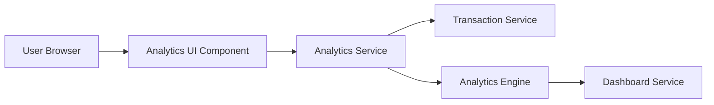

#### 1. High-Level Design

- **Summary:** This epic delivers interactive analytical capabilities that help users understand spending patterns through visual representations and category-based analysis. Users can explore monthly spending trends over time and analyze expenditures across predefined categories (Food & Dining, Fuel, Shopping, Travel, Entertainment, Utilities, Healthcare, Education, Miscellaneous). The feature provides card-wise spend analysis, enabling users to compare spending across different credit cards and identify usage patterns by category.

- **Component Flow:**

- **Integration Points:**
  - **Upstream:** Transaction Service (provides spending data), Analytics Engine (aggregates and calculates category-wise metrics), Dashboard Service (displays trend data)
  - **Downstream:** Analytics UI renders interactive charts and graphs with drill-down capabilities for end users

- **Key Assumptions:**
  - Transactions are pre-categorized into the nine predefined categories by an upstream service or categorization logic not detailed in the epic.
  - Analytics Engine performs aggregation and caching to ensure visualizations render within the 3-second requirement even for large transaction datasets.

- **NFR Highlights:** Analytics visualizations must render within 3 seconds; system must support interactive filtering and drill-down capabilities; charts must be responsive and accessible across all device types.

#### 2. Validation Report

- **Requirements Coverage:** The design fully addresses the epic's scope including Category-wise spending visualization, Monthly spend trends analysis, Card-wise spend analysis, Interactive charts and graphs, Spending pattern identification, and Multi-dimensional spending breakdowns. The architecture supports all specified NFRs through optimized aggregation, caching strategies, and responsive visualization components. All integration dependencies with Transaction Service, Analytics Engine, and Dashboard Service are incorporated into the component flow, ensuring seamless data flow for analytical insights.