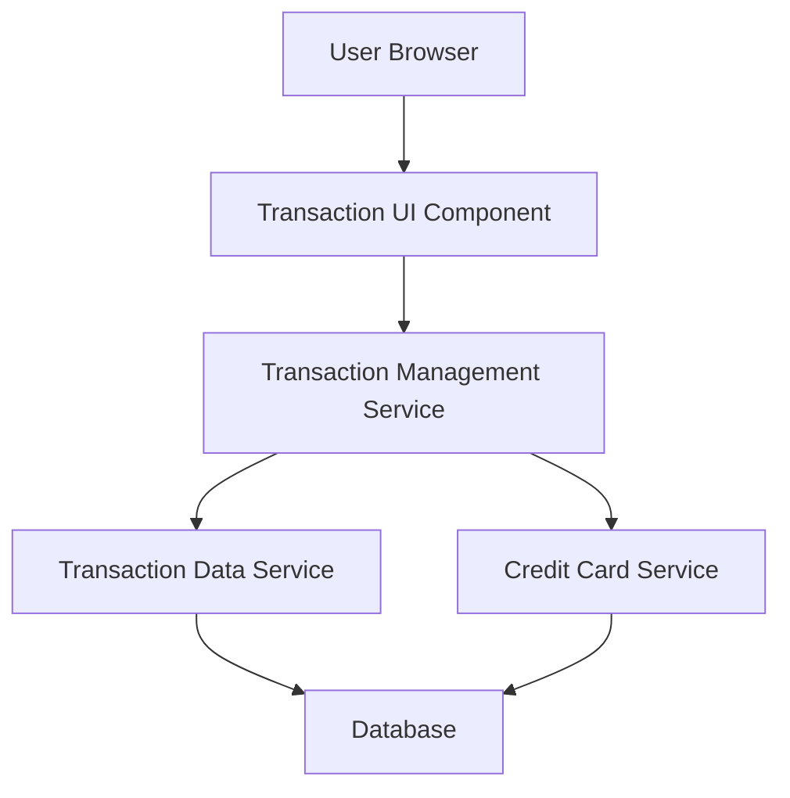

#### 1. High-Level Design

- **Summary:** This epic provides comprehensive transaction tracking capabilities across all user credit cards. Users can view, search, and filter transactions to understand spending behavior and verify card activity. The system displays detailed transaction information and calculates spending metrics that feed into dashboard KPIs, ensuring complete transparency into credit card usage.

- **Component Flow:**

- **Integration Points:**
  - **Upstream:** Transaction Data Service (retrieves transaction records), Credit Card Service (maps transactions to specific cards)
  - **Downstream:** Transaction UI displays filtered and paginated transaction data; metrics feed into Dashboard KPIs

- **Key Assumptions:**
  - Transaction data is indexed by user ID, card ID, and transaction date to support sub-1-second retrieval with filtering.
  - Pagination is implemented with a default page size (e.g., 50 transactions per page) to handle up to 10,000 transactions per user efficiently.

- **NFR Highlights:** System must handle up to 10,000 transactions per user without performance degradation; transaction retrieval must complete within 1 second; data must be displayed in chronological order with pagination support.

#### 2. Validation Report

- **Requirements Coverage:** The design comprehensively covers the epic's scope including Transaction listing, Transaction viewing, Transaction filtering, Transaction search, Multi-card transaction aggregation, and Transaction date range selection. The architecture supports all specified NFRs through indexed data retrieval, pagination, and optimized query patterns. Integration dependencies with Transaction Data Service and Credit Card Service are clearly defined and support the required functionality.