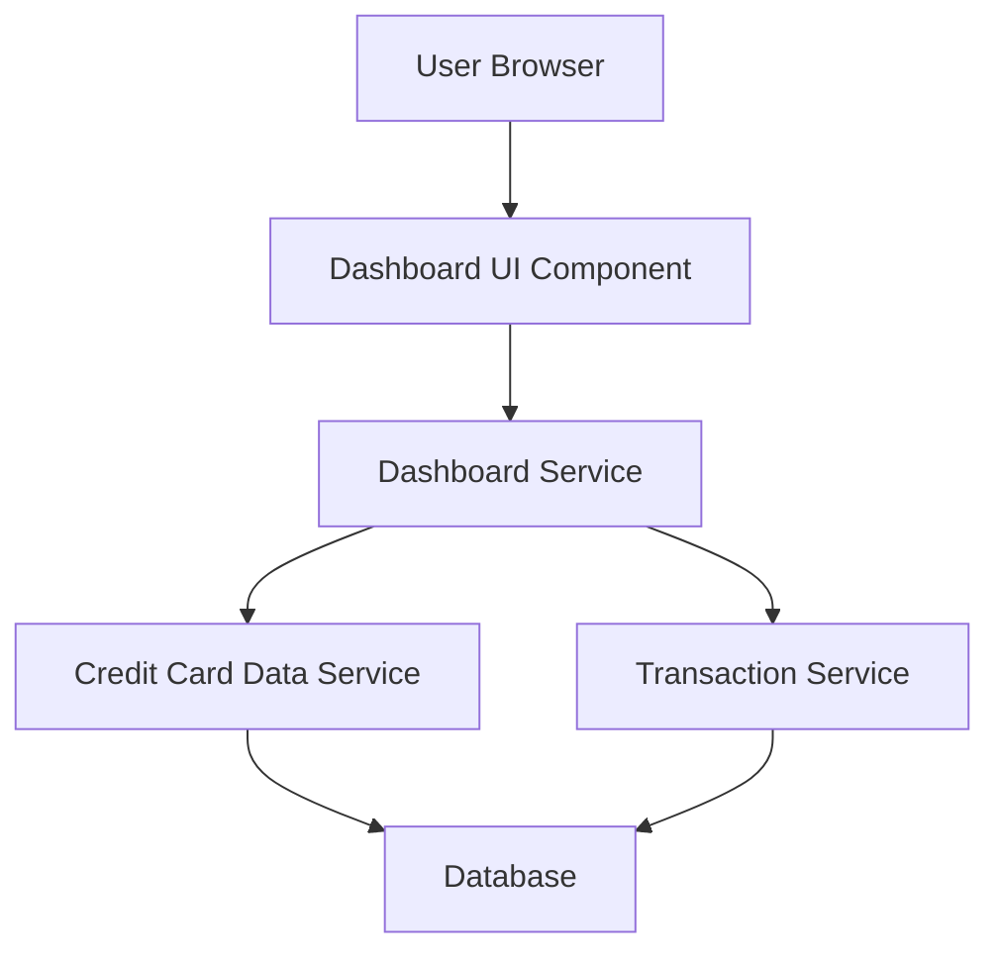

#### 1. High-Level Design

- **Summary:** This epic delivers a consolidated dashboard that displays key performance indicators (KPIs) for all user credit cards in a single, responsive interface. Users can monitor monthly spend, total credit limit, available credit, and outstanding amounts across multiple cards, providing real-time visibility into their credit card portfolio and overall financial health.

- **Component Flow:**

- **Integration Points:**
  - **Upstream:** Credit Card Data Service (retrieves card information and balances), Transaction Service (calculates monthly spend metrics)
  - **Downstream:** Dashboard UI renders aggregated KPI data for end-user consumption

- **Key Assumptions:** 
  - Credit Card Data Service and Transaction Service provide real-time or near-real-time data updates to meet the 2-second load time requirement.
  - Available credit is calculated as (Total Credit Limit - Outstanding Amount) within the Dashboard Service layer.

- **NFR Highlights:** Dashboard must load within 2 seconds; must support responsive design across desktop, tablet, and mobile devices; UI must comply with WCAG 2.1 accessibility standards.

#### 2. Validation Report

- **Requirements Coverage:** The design fully covers the epic's stated scope including Dashboard KPI display, Monthly Spend tracking, Total Credit Limit aggregation, Available Credit calculation, Outstanding Amount display, Multiple credit card view, and Responsive layout design. The architecture supports the specified NFRs through optimized service calls and responsive UI components. All integration dependencies with Credit Card Data Service and Transaction Service are addressed in the component flow.