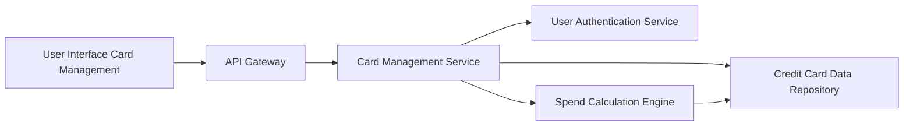

#### 1. High-Level Design

- **Summary:** This epic enables users to manage and monitor multiple credit cards from a unified interface. Users can view all registered cards with individual details, track card-specific spending patterns, and analyze usage across their entire portfolio. The feature provides card-wise spend analysis to help users understand which cards are being utilized most effectively.

- **Component Flow:**

- **Integration Points:**
  - **Upstream:** User authentication service (provides secure card access with user identity verification)
  - **Upstream:** Credit card data repository (stores and retrieves card information securely)
  - **Upstream:** Spend calculation engine (performs card-wise spend analysis and aggregations)
  - **Downstream:** Credit card data repository (persists card registration and details)

- **Key Assumptions:**
  - Card registration requires manual user input of card details (card number, expiry, issuer) with validation but no real bank integration.
  - Card-wise spend analysis aggregates transactions by card identifier with calculations performed daily or on-demand (assumed: daily batch + on-demand refresh).

- **NFR Highlights:** Support ≥10 cards per user; card data retrieval within 1 second; secure storage and display of card information (encryption at rest and in transit).

- **Data Flow:** User accesses card management interface → API Gateway authenticates via User Authentication Service → Card Management Service retrieves user's registered cards from Credit Card Data Repository → For each card, Spend Calculation Engine computes card-wise spending metrics by querying transaction data → Card Management Service aggregates card details with spending analysis → UI renders card list with individual card details, spend patterns, and filtering options → User can select/filter cards to view detailed card-specific information and usage analytics.

#### 2. Validation Report

- **Requirements Coverage:** The design fully addresses multiple credit card display, card registration and listing, card-wise spend analysis, individual card details view, and card selection/filtering. All NFRs (10+ cards per user, 1-second retrieval, secure storage/display) are satisfied through efficient data modeling, indexed queries, and security controls (encryption, authentication). Integration dependencies with user authentication service, credit card data repository, and spend calculation engine are clearly mapped and support the required multi-card management and tracking capabilities.