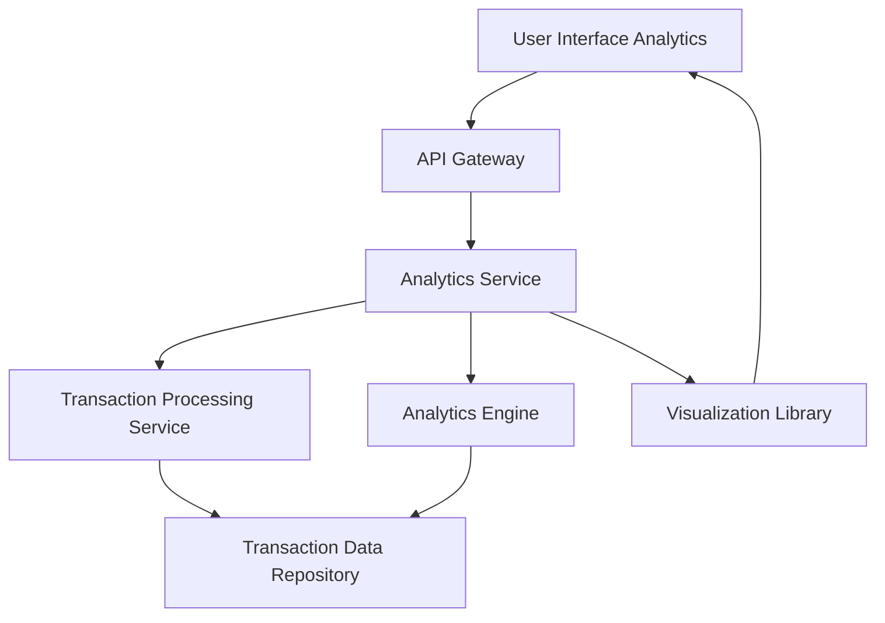

#### 1. High-Level Design

- **Summary:** This epic provides comprehensive transaction tracking and category-wise spending analytics through interactive visualizations. Users can analyze spending patterns across nine predefined categories (Food & Dining, Fuel, Shopping, Travel, Entertainment, Utilities, Healthcare, Education, Miscellaneous) and view monthly spend trends to identify patterns and make informed financial decisions.

- **Component Flow:**

- **Integration Points:**
  - **Upstream:** Transaction processing service (retrieves transaction data with category classifications)
  - **Upstream:** Analytics engine (generates spending insights, trend analysis, aggregations)
  - **Upstream:** Visualization library (renders interactive charts and graphs on frontend)
  - **Downstream:** Transaction data repository (stores categorized transaction records)

- **Key Assumptions:**
  - Transaction category classification is performed automatically at transaction ingestion time using rule-based or ML-based categorization (ownership: Transaction Processing Service).
  - Monthly trend analysis aggregates data on a calendar month basis with historical data retained for at least 12 months.

- **NFR Highlights:** Analytics visualizations render within 3 seconds; system handles ≥1000 transactions per user per month; category classification accuracy and consistency maintained.

- **Data Flow:** User accesses analytics view → API Gateway routes request → Analytics Service queries Transaction Processing Service for filtered/categorized transactions → Transaction Processing Service retrieves data from Transaction Data Repository → Analytics Engine performs aggregations (category-wise totals, monthly trends, pattern analysis) → Analytics Service formats data for visualization → Visualization Library renders interactive charts (pie charts for category distribution, line/bar charts for monthly trends) → UI displays analytics dashboard with filtering and search capabilities.

#### 2. Validation Report

- **Requirements Coverage:** The design comprehensively covers transaction listing and tracking, category-wise spending visualization, monthly spend trend analysis, interactive charts, nine predefined categories, and transaction filtering/search. All NFRs (3-second render time, 1000+ transactions/month capacity, category classification accuracy) are addressed through efficient data aggregation, caching, and optimized visualization rendering. Integration dependencies with transaction processing service, analytics engine, and visualization library are explicitly defined and support the required functionality.