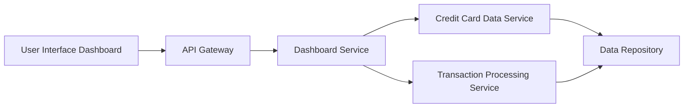

#### 1. High-Level Design

- **Summary:** This epic delivers a centralized, responsive dashboard that displays key performance indicators (KPIs) for the user's credit card portfolio. The dashboard aggregates and presents critical financial metrics including monthly spend, total credit limit, available credit, and outstanding amounts across all registered cards, providing users with a consolidated view of their credit card financial health.

- **Component Flow:**

- **Integration Points:**
  - **Upstream:** Credit card data service (retrieves card information, balances, credit limits)
  - **Upstream:** Transaction processing service (calculates monthly spend and outstanding amounts)
  - **Downstream:** Data repository (stores aggregated card and transaction data)

- **Key Assumptions:**
  - KPI calculations are performed server-side with cached results refreshed in near real-time (assumed refresh interval: every 30-60 seconds).
  - Available credit is calculated as (Total Credit Limit - Outstanding Amount) with data consistency maintained across services.

- **NFR Highlights:** Dashboard load time ≤2 seconds; responsive design across desktop/tablet/mobile; real-time data refresh for KPI metrics.

- **Data Flow:** User accesses dashboard → API Gateway authenticates and routes request → Dashboard Service orchestrates calls to Credit Card Data Service (fetches card details, limits, balances) and Transaction Processing Service (fetches monthly spend, outstanding amounts) → Services query Data Repository → Aggregated KPI data returned to Dashboard Service → Dashboard Service formats and returns consolidated metrics → UI renders responsive dashboard with KPIs displayed in cards/widgets.

#### 2. Validation Report

- **Requirements Coverage:** The design fully covers the epic's stated scope including monthly spend display, total credit limit tracking, available credit calculation, outstanding amount monitoring, responsive layout, and consolidated multi-card view. All NFRs (2-second load time, responsive design, real-time refresh) are addressed through service orchestration, caching strategies, and frontend optimization. Integration dependencies with credit card data service and transaction processing service are explicitly mapped in the component flow.