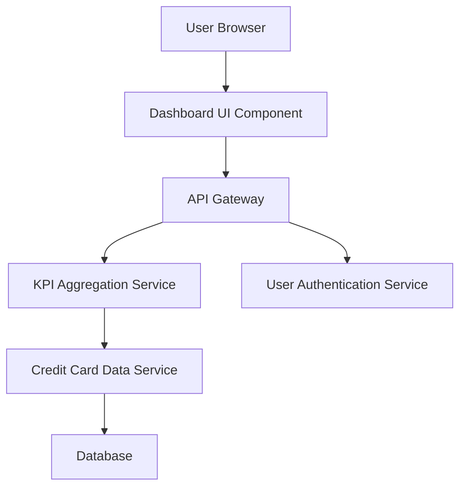

#### 1. High-Level Design

- **Summary:** This epic delivers a comprehensive dashboard that consolidates key performance indicators for credit card portfolio management. Users can monitor monthly spend, total credit limit, available credit, and outstanding amounts in real-time, providing a single-pane view of their credit card financial health to support informed financial decisions and credit utilization optimization.

- **Component Flow:**

- **Integration Points:**
  - **Upstream:** User Authentication Service (for secure access and user identity validation)
  - **Downstream:** Credit Card Data Service (for fetching card details, transaction data, and calculating KPIs)

- **Key Assumptions:**
  - KPI calculations (available credit, outstanding amounts) are computed server-side and cached for performance; data refresh frequency is configurable (assumed every 5-15 minutes for "real-time" updates).
  - Dashboard supports standard web browsers and mobile responsive layouts; no native mobile app integration assumed.

- **NFR Highlights:** Dashboard must load within 2 seconds, support responsive layouts across desktop and mobile devices, handle real-time data refresh for KPI updates.

#### 2. Validation Report

- **Requirements Coverage:** The design fully covers the epic's stated scope including monthly spend display, total credit limit tracking, available credit calculation, outstanding amount monitoring, and responsive UI implementation. The architecture supports the 2-second load time requirement through caching and aggregation services. All integration dependencies (credit card data service, authentication service) are accounted for in the component flow. Out-of-scope items (real bank integration, payment processing, fund transfers) are appropriately excluded from the design.