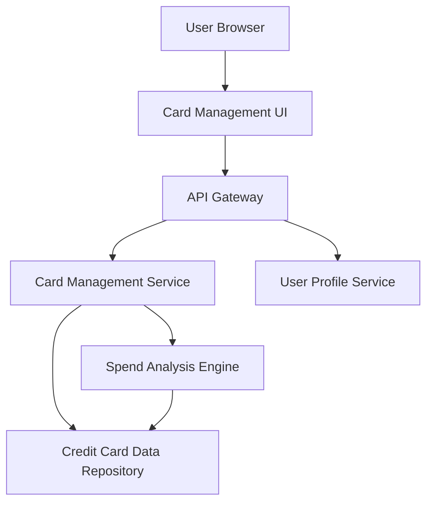

#### 1. High-Level Design

- **Summary:** This epic provides a unified interface for users to view and manage multiple credit cards (up to 50 per user). Users can see consolidated card listings, drill down into individual card details, track card-specific spending, and analyze financial activity across different cards. The feature supports multi-card portfolio management with filtering and selection capabilities.

- **Component Flow:**

- **Integration Points:**
  - **Upstream:** User Profile Service (for card ownership validation and user account management)
  - **Downstream:** Credit Card Data Repository (for retrieving card information, balances, and transaction history)

- **Key Assumptions:**
  - Card data is pre-loaded and stored in the repository; no real-time bank API calls are made (mock/demo data or periodic batch sync assumed).
  - Card-wise spend analysis aggregates transaction data by card ID; categorization is handled separately by the Analytics epic.

- **NFR Highlights:** System must support display of up to 50 credit cards per user, card data retrieval must complete within 1 second, ensure data isolation between different user accounts.

#### 2. Validation Report

- **Requirements Coverage:** The design addresses all scope elements including multiple credit card display, card-wise spend analysis, individual card details view, card listing interface, and card selection/filtering. The architecture supports the 1-second retrieval requirement and 50-card capacity through efficient data repository design and caching strategies. Data isolation is enforced through user profile service validation. Out-of-scope items (real bank integration, card payments, adding external cards, card application process, loans) are correctly excluded.