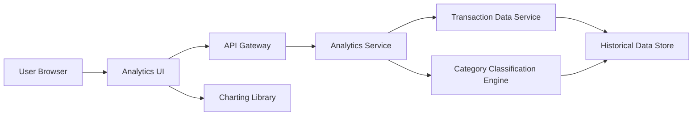

#### 1. High-Level Design

- **Summary:** This epic delivers interactive visualizations and analytics for understanding spending patterns and trends. Users can explore category-wise spending breakdowns across 9 predefined categories (Food & Dining, Fuel, Shopping, Travel, Entertainment, Utilities, Healthcare, Education, Miscellaneous) and analyze monthly spend trends over time. The feature enables data-driven budget management and spending optimization through visual insights.

- **Component Flow:**

- **Integration Points:**
  - **Upstream:** Transaction Data Service (for retrieving spending records and transaction history)
  - **Downstream:** Category Classification Engine (for transaction categorization into predefined spending categories)
  - **Client-side:** Charting Library (for rendering interactive visualizations in the browser)

- **Key Assumptions:**
  - Transactions are pre-categorized by the classification engine using rule-based or ML models; manual recategorization is not in scope.
  - Historical data retention is 12 months minimum; older data may be archived or aggregated for performance.

- **NFR Highlights:** Analytics visualizations must render within 3 seconds, support interactive filtering and drill-down capabilities, handle historical data for at least 12 months.

#### 2. Validation Report

- **Requirements Coverage:** The design comprehensively covers all scope items including category-wise spending visualization, monthly spend trends analysis, interactive charts and graphs, spending pattern identification, multi-category breakdown, and trend comparison. The architecture supports the 3-second rendering requirement through optimized data queries and client-side charting. All dependencies (transaction data service, category classification engine, charting library) are integrated. The 12-month historical data requirement is accommodated in the data store design. Out-of-scope items (real bank integration, predictive analytics, budget alerts, spending recommendations, third-party integrations) are appropriately excluded.