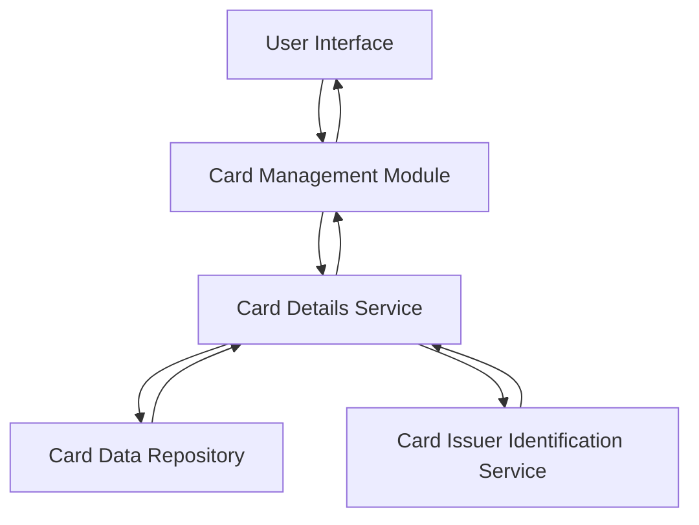

#### 1. High-Level Design

- **Summary:** This epic enables users to manage and view multiple credit cards within a unified dashboard interface. Users can view all registered cards, access card-specific details (card numbers, types, limits, balances), and navigate between cards for detailed analysis. The feature provides a comprehensive view of each card's status with appropriate security measures.

- **Component Flow:**

- **Integration Points:** 
  - Credit card data repository or service for storing and retrieving card information
  - Card issuer identification services for card branding and visual representation
  - Secure data masking service for sensitive card information display

- **Key Assumptions:** 
  - Card data is stored in a normalized format with unique identifiers per card
  - Sensitive card information (full card numbers) is masked by default, showing only last 4 digits

- **NFR Highlights:** System must support display of at least 10 credit cards per user; Card data retrieval must be efficient with minimal latency; Secure display of sensitive card information with appropriate masking

#### 2. Validation Report

- **Requirements Coverage:** The design addresses all requirements including display of multiple credit cards, card-specific details view, card identification and labeling, card-wise balance tracking, card selection and navigation, and card status indicators. The architecture supports the NFR of displaying at least 10 cards per user with efficient data retrieval and secure information masking. The component flow ensures separation of concerns between UI, business logic, and data access layers.