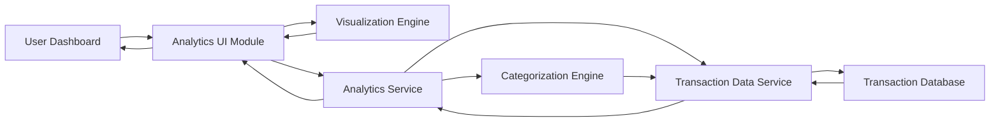

#### 1. High-Level Design

- **Summary:** This epic delivers interactive visualizations and analytics capabilities for users to understand spending patterns. It includes monthly spend trend analysis, category-wise spending breakdowns across nine predefined categories (Food & Dining, Fuel, Shopping, Travel, Entertainment, Utilities, Healthcare, Education, Miscellaneous), and card-wise spend comparison with time-based filtering capabilities.

- **Component Flow:**

- **Integration Points:** 
  - Transaction data service or database for retrieving historical spending data
  - Charting libraries (e.g., Chart.js, D3.js) for visualization rendering
  - Transaction categorization logic or service for mapping transactions to predefined categories
  - Filtering and aggregation service for time-based and card-wise analysis

- **Key Assumptions:** 
  - Transactions are pre-categorized or categorized on-the-fly using rule-based or ML-based categorization logic
  - Historical transaction data is retained for at least 12 months to support meaningful trend analysis

- **NFR Highlights:** Visualizations must render within 2 seconds; Charts must be interactive and responsive; System must handle historical transaction data for trend analysis; Support filtering and drill-down capabilities

#### 2. Validation Report

- **Requirements Coverage:** The design comprehensively covers all stated requirements including monthly spend trend visualization, category-wise spending analysis across nine predefined categories, card-wise spend comparison, interactive charts and graphs, spending pattern identification, and time-based filtering. The architecture supports the NFRs with a dedicated visualization engine for fast rendering (within 2 seconds), interactive and responsive charts, and efficient handling of historical transaction data with filtering and drill-down capabilities. The separation of categorization logic ensures maintainability and scalability.