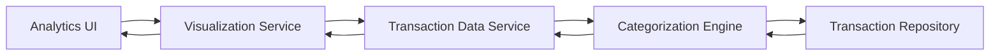

#### 1. High-Level Design

- **Summary:** This epic provides interactive visualizations and analytics to help users understand spending behavior across categories (Food & Dining, Fuel, Shopping, Travel, Entertainment, Utilities, Healthcare, Education, Miscellaneous). Users can view monthly spend trends over time and analyze category-wise spending patterns through interactive charts and graphs, enabling data-driven financial decisions.

- **Component Flow:**

- **Integration Points:** 
  - **Upstream:** Transaction Data Service/Repository (provides historical transaction data for at least 12 months)
  - **Internal:** Transaction Categorization Engine (categorizes transactions into predefined spending categories)
  - **External:** Charting Library Integration (for rendering interactive visualizations)

- **Key Assumptions:** 
  - Transactions are either pre-categorized in the repository or categorized on-the-fly by the categorization engine.
  - Historical data retention policy supports at least 12 months of transaction history for trend analysis.

- **NFR Highlights:** Visualizations must render within 3 seconds, support interactive filtering and drill-down capabilities, and handle historical data for at least 12 months of transactions.

#### 2. Validation Report

- **Requirements Coverage:** The design comprehensively covers all stated requirements including category-wise spending visualization, monthly spend trend analysis, interactive charts/graphs, spending breakdown by all specified categories, and card-wise spend analysis. The architecture supports the NFRs for performance (3-second render time), interactivity (filtering and drill-down), and data retention (12 months historical data). All dependencies including transaction data service, categorization engine, and charting library are incorporated into the component flow.