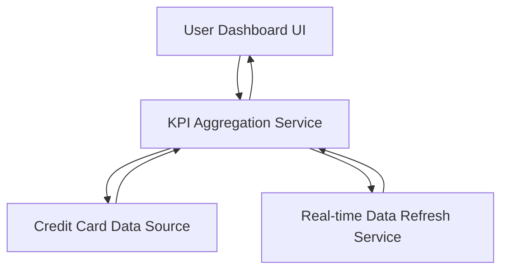

#### 1. High-Level Design

- **Summary:** This epic delivers a consolidated dashboard that displays key performance indicators (KPIs) for the user's credit card portfolio. The dashboard provides real-time visibility into monthly spend, total credit limit, available credit, and outstanding amounts across all cards through a responsive interface that aggregates multi-card data into a unified view.

- **Component Flow:**

- **Integration Points:** 
  - **Upstream:** Credit Card Data Source or Mock Data Service (provides card balances, limits, transaction data)
  - **Internal:** Real-time Data Refresh Service (enables KPI updates without full page reload)

- **Key Assumptions:** 
  - KPI calculations (available credit, total limits, monthly spend) are computed by the aggregation service based on raw card data.
  - Real-time refresh operates on a polling or push mechanism with a defined refresh interval (not specified in epic).

- **NFR Highlights:** Dashboard must load within 2 seconds, support responsive design across desktop and mobile devices, and handle real-time data refresh for KPI updates.

#### 2. Validation Report

- **Requirements Coverage:** The design addresses all core requirements including monthly spend display, total credit limit aggregation, available credit calculation, outstanding amount tracking, responsive layout, and multi-card consolidated view. The architecture incorporates the NFRs for performance (2-second load time), responsiveness (cross-device support), and real-time refresh capability. The identified dependency on credit card data source is integrated into the component flow.