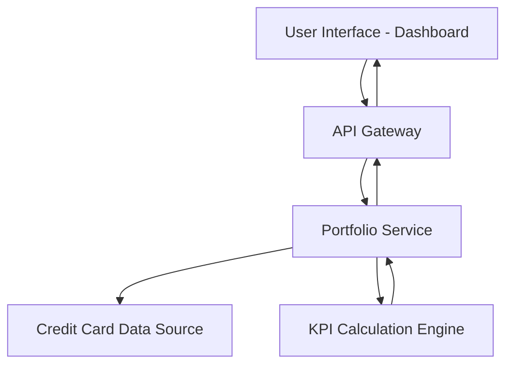

#### 1. High-Level Design

- **Summary:** This epic delivers a consolidated credit card portfolio dashboard that displays key performance indicators (KPIs) including monthly spend, total credit limit, available credit, and outstanding amounts across all user credit cards. The solution provides a unified, responsive interface for users to monitor their financial health and credit utilization in real-time.

- **Component Flow:**

- **Integration Points:** 
  - Credit card data source or mock data service for retrieving card details, balances, and credit limits
  - Backend API for aggregating multi-card data and calculating KPIs

- **Key Assumptions:** 
  - Card data is available via REST API with standardized response format; KPI calculations (available credit, outstanding amounts) are performed server-side with data refresh frequency of near real-time or periodic polling.

- **NFR Highlights:** Responsive layouts across desktop, tablet, and mobile devices; Dashboard must load and display all KPIs within acceptable performance thresholds for optimal user experience.

#### 2. Validation Report

- **Requirements Coverage:** The design covers all stated requirements including dashboard KPIs display, multiple credit card view, monthly spend tracking, credit limit aggregation, available credit calculation, outstanding amount monitoring, and responsive layout. The component flow ensures separation of concerns with dedicated services for data retrieval and KPI calculations. All in-scope items are addressed while explicitly excluding out-of-scope elements (real bank integration, payments, transfers, loans).