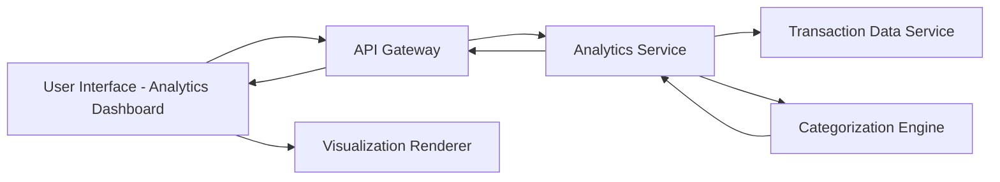

#### 1. High-Level Design

- **Summary:** This epic provides interactive visualizations and analytical capabilities for users to understand spending patterns through category-wise analysis and monthly spend trends. The solution supports 9 predefined spending categories (Food & Dining, Fuel, Shopping, Travel, Entertainment, Utilities, Healthcare, Education, Miscellaneous) and enables card-wise spend comparison with interactive charts and graphs.

- **Component Flow:**

- **Integration Points:** 
  - Transaction data service for aggregating and categorizing spending data
  - Analytics processing engine for trend calculations and pattern analysis
  - Frontend visualization library for rendering interactive charts

- **Key Assumptions:** 
  - Transactions are pre-categorized or categorization logic exists to map transactions to 9 predefined categories; Monthly aggregations are calculated on-demand or pre-computed for performance.

- **NFR Highlights:** Visualizations must render smoothly with interactive elements; Analytics calculations must be accurate and performant; Charts must be responsive and adapt to different screen sizes.

#### 2. Validation Report

- **Requirements Coverage:** The design comprehensively covers all stated requirements including category-wise spending visualization, monthly spend trends analysis, card-wise spend analysis, interactive charts and graphs, spending pattern identification, and multi-category support for 9 spending categories. The categorization engine ensures accurate classification of transactions, while the visualization renderer provides responsive, interactive charts. NFRs for smooth rendering, accuracy, performance, and responsiveness are addressed through dedicated components. Out-of-scope elements (predictive analytics, budget recommendations, spending alerts, custom categories, export functionality) are appropriately excluded.