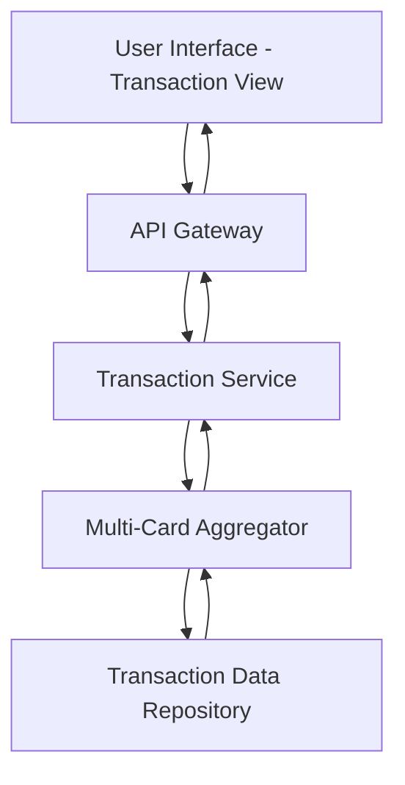

#### 1. High-Level Design

- **Summary:** This epic enables users to view and access credit card transactions across all their cards through a unified interface. Users can review transaction history, details, and associated information to understand spending behavior and verify charges. The solution aggregates transactions from multiple cards and presents them in a responsive, performant interface.

- **Component Flow:**

- **Integration Points:** 
  - Transaction data service or repository for retrieving historical and current transaction records across multiple credit cards
  - Backend API for transaction aggregation and filtering

- **Key Assumptions:** 
  - Transaction data is stored in a centralized repository accessible via API; Transaction records include standard fields (date, amount, merchant, category) with pagination support for large datasets.

- **NFR Highlights:** System must handle transaction data efficiently and display transaction lists with smooth scrolling and quick load times; Interface must be responsive across all device types.

#### 2. Validation Report

- **Requirements Coverage:** The design addresses all in-scope requirements including transaction list view, transaction details display, multi-card transaction aggregation, transaction history access, and responsive transaction interface. The multi-card aggregator component ensures seamless consolidation of transactions from multiple sources. The architecture supports efficient data handling and responsive UI as specified in NFRs. Out-of-scope items (real bank integration, payments, real-time alerts) are appropriately excluded.