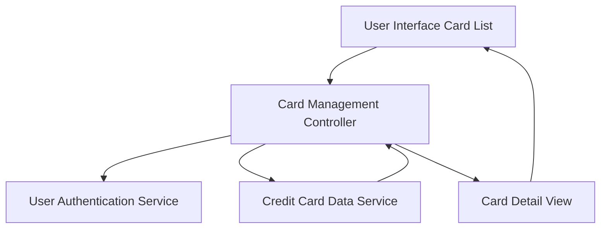

### 1. High-Level Design

**Summary:**  
This epic provides a centralized interface for users to manage and view multiple credit cards simultaneously. Users can access a list of all registered cards, view individual card details, and monitor card-specific metrics including credit limits, available credit, outstanding balances, and spending analysis for each card.

**Component Flow:**

**Integration Points:**
- **Upstream:** Credit Card Data Service (stores and retrieves card information including limits, balances, and spend data)
- **Upstream:** User Authentication Service (associates cards with authenticated user accounts)
- **Internal:** Card Management Controller (orchestrates card list and detail views)

**Key Assumptions:**
- Each user account can be associated with multiple credit cards through the User Authentication Service.
- Card data structure is consistent across all cards to enable uniform display and management.

**NFR Highlights:**  
System must support viewing and managing multiple credit cards per user; Interface must maintain performance with increasing number of cards; Responsive design must accommodate card list views on all device sizes.

### 2. Validation Report

**Requirements Coverage:**  
The design addresses all requirements including Multiple credit card display, Individual card detail views, Card-wise credit limit display, Card-wise available credit display, Card-wise outstanding balance display, and Card-wise spend analysis. The architecture integrates with both Credit Card Data Service and User Authentication Service as specified in dependencies. The component flow supports scalable card management and maintains separation between list and detail views. The design aligns with NFRs for multi-card support, performance scalability, and responsive design.