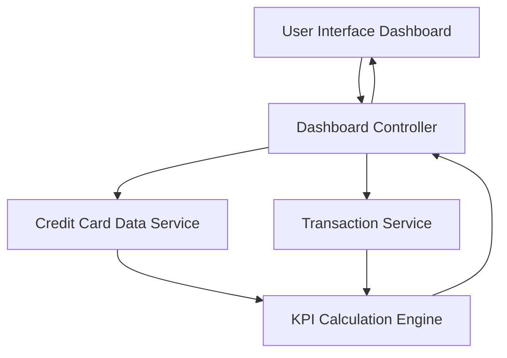

### 1. High-Level Design

**Summary:**  
This epic delivers a consolidated financial dashboard that displays key performance indicators (KPIs) across all user credit cards. Users can view monthly spend, total credit limit, available credit, and outstanding amounts in a single responsive interface, enabling comprehensive credit card financial health monitoring.

**Component Flow:**

**Integration Points:**
- **Upstream:** Credit Card Data Service (retrieves card balances and limits)
- **Upstream:** Transaction Service (provides transaction data for monthly spend and outstanding amounts calculation)
- **Internal:** KPI Calculation Engine (aggregates data from multiple sources)

**Key Assumptions:**
- Data from Credit Card Data Service and Transaction Service is available in real-time or near-real-time for accurate KPI display.
- Multi-card aggregation logic assumes standardized data format across all cards.

**NFR Highlights:**  
Dashboard must be responsive across desktop, tablet, and mobile devices; Page load time must support real-time KPI calculations; UI must support multiple credit cards without performance degradation.

### 2. Validation Report

**Requirements Coverage:**  
The design covers all stated requirements including Monthly Spend KPI display, Total Credit Limit calculation, Available Credit calculation, Outstanding Amount tracking, Consolidated multi-card view, and Responsive dashboard layout. The component flow demonstrates integration with required upstream services (Credit Card Data Service and Transaction Service) and includes a KPI Calculation Engine to aggregate and compute metrics. The architecture supports the specified NFRs for responsiveness and performance across multiple cards.