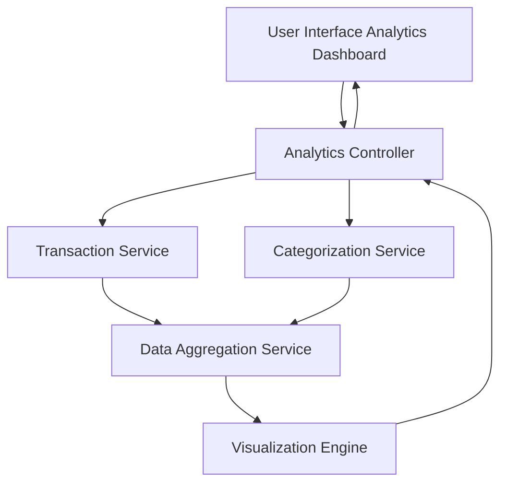

### 1. High-Level Design

**Summary:**  
This epic delivers interactive spending analytics with visualizations that help users understand spending patterns across predefined categories (Food & Dining, Fuel, Shopping, Travel, Entertainment, Utilities, Healthcare, Education, Miscellaneous). Users can view monthly spend trends over time and analyze category-wise breakdowns through interactive charts and graphs.

**Component Flow:**

**Integration Points:**
- **Upstream:** Transaction Service (retrieves transaction data for analysis)
- **Upstream:** Categorization Service (classifies transactions into spending categories)
- **Upstream:** Data Aggregation Service (calculates category totals and monthly trends)
- **Internal:** Visualization Engine (renders interactive charts and graphs)

**Key Assumptions:**
- Transactions are pre-categorized or categorization logic is applied at display time using predefined rules.
- Historical transaction data is retained for at least 12 months to support meaningful trend analysis.

**NFR Highlights:**  
Visualizations must be interactive and responsive; Analytics must support historical data for monthly trend analysis; Charts must render efficiently with large transaction datasets; UI must be responsive across all device types.

### 2. Validation Report

**Requirements Coverage:**  
The design comprehensively covers all requirements including Monthly spend trend visualization, Category-wise spending analysis, Interactive charts and graphs, and Spending breakdowns across all nine specified categories (Food & Dining, Fuel, Shopping, Travel, Entertainment, Utilities, Healthcare, Education, Miscellaneous), plus Transaction categorization display. The architecture integrates with all specified dependencies: Transaction Service, Categorization Service, and Data Aggregation Service. The Visualization Engine component supports interactive and responsive chart rendering. The design addresses all stated NFRs for interactivity, historical data support, efficient rendering with large datasets, and responsive UI across device types.