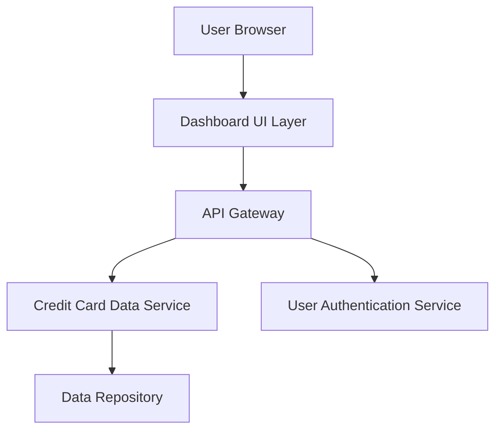

#### 1. High-Level Design

- **Summary:** This epic delivers a responsive dashboard interface that consolidates all user credit cards into a single view with key performance indicators (KPIs) including monthly spend, total credit limit, available credit, and outstanding amounts. The dashboard serves as the primary entry point for users to monitor their credit card portfolio health and financial status in real-time.

- **Component Flow:**

- **Integration Points:**
  - **Upstream:** User Authentication Service (for personalized dashboard access)
  - **Downstream:** Credit Card Data Source/Service (for retrieving card information, balances, and limits)
  - **Data Layer:** Credit card data repository or mock data service

- **Key Assumptions:**
  - Credit card data is available via REST API in JSON format with real-time or near-real-time refresh capability.
  - User authentication is handled by an existing identity service; dashboard assumes authenticated session context.

- **NFR Highlights:** Dashboard must be responsive across desktop, tablet, and mobile devices; page load time optimized for quick KPI rendering; UI supports real-time data refresh for accurate financial metrics.

#### 2. Validation Report

- **Requirements Coverage:** The design fully covers the epic's stated scope including dashboard interface development, KPI displays (monthly spend, total credit limit, available credit, outstanding amount), responsive layout, and multi-card consolidated view. All NFRs related to responsiveness, load time optimization, and real-time refresh are addressed through the layered architecture with dedicated UI, API, and data service components.