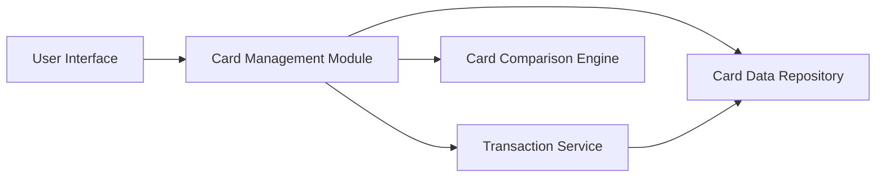

#### 1. High-Level Design

- **Summary:** This epic enables users to view, manage, and track multiple credit cards with detailed card-specific information including spending, credit limits, and outstanding balances. Users can perform card-wise spend analysis and compare performance across different cards to make informed decisions about card usage based on available credit and spending patterns.

- **Component Flow:**

- **Integration Points:**
  - **Upstream:** Transaction Service (to calculate card-wise spending)
  - **Downstream:** Credit Card Data Repository/Service (for card details and metadata)
  - **External:** Card Issuer Data Feeds (optional, for card information updates)

- **Key Assumptions:**
  - Each card has a unique identifier; card data includes spending history aggregated by card ID.
  - Card comparison logic is based on standard metrics (utilization rate, available credit, spending velocity).

- **NFR Highlights:** System must support display of multiple cards simultaneously without performance degradation; card data updates reflected accurately across all views; interface handles varying numbers of cards per user efficiently.

#### 2. Validation Report

- **Requirements Coverage:** The design comprehensively addresses the epic's scope including multiple credit card display, card-wise spend analysis, individual card details view, card-specific tracking (credit limit, outstanding balance), and card comparison capabilities. The modular architecture with dedicated Card Management Module and Card Comparison Engine ensures scalability and performance as specified in NFRs. Integration with Transaction Service and Card Data Repository provides the necessary data foundation for all card management features.