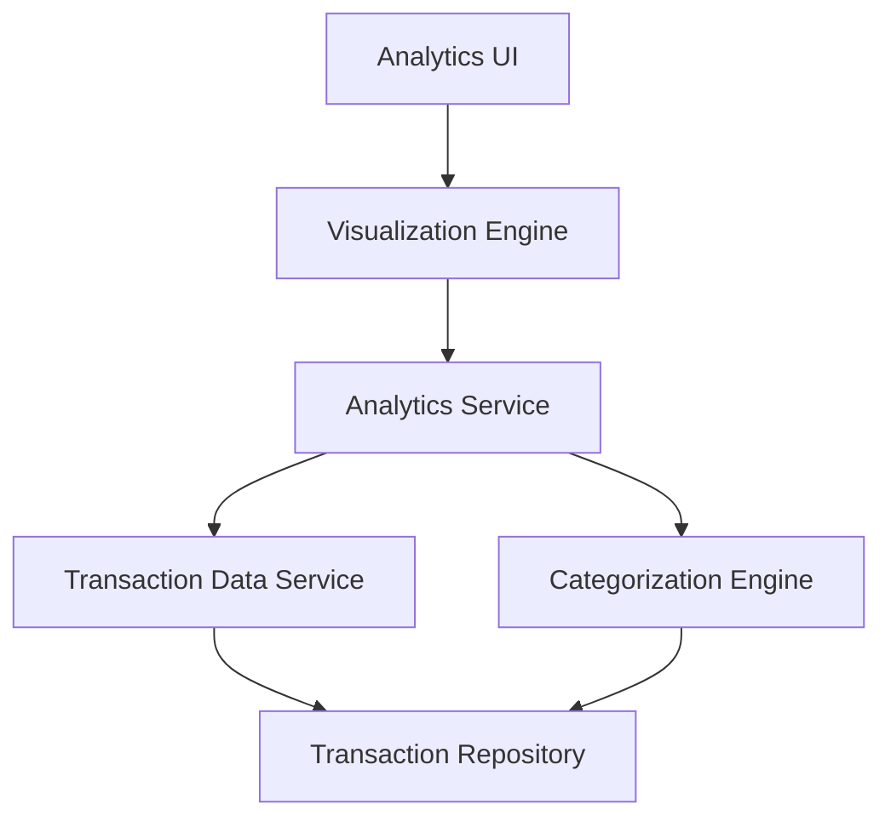

#### 1. High-Level Design

- **Summary:** This epic delivers comprehensive analytics and visualization capabilities enabling users to understand spending patterns through interactive charts and category-based analysis. Users can view monthly spend trends over time and analyze transactions across 9 predefined categories (Food & Dining, Fuel, Shopping, Travel, Entertainment, Utilities, Healthcare, Education, Miscellaneous), providing actionable insights for budget management and financial planning.

- **Component Flow:**

- **Integration Points:**
  - **Upstream:** Transaction Data Service/Repository (for historical transaction records)
  - **Internal:** Categorization Engine/Service (to classify transactions into 9 predefined categories)
  - **External:** Charting Libraries (for visualization rendering - e.g., D3.js, Chart.js)

- **Key Assumptions:**
  - Transactions are pre-tagged or can be auto-categorized using merchant codes or description patterns into the 9 defined categories.
  - Monthly aggregation is calculated server-side; visualizations consume aggregated data for performance.

- **NFR Highlights:** Analytics visualizations must render efficiently even with large transaction datasets; category calculations must be accurate and consistent; interactive charts responsive with minimal latency for user interactions.

#### 2. Validation Report

- **Requirements Coverage:** The design fully satisfies the epic's scope including monthly spend trends visualization, category-wise spending analysis across all 9 categories, interactive data visualizations, transaction categorization, spending pattern identification, and transaction history view. The architecture separates concerns with dedicated Visualization Engine, Analytics Service, and Categorization Engine to meet NFRs around rendering efficiency, calculation accuracy, and interaction responsiveness. Integration with Transaction Data Service and charting libraries provides the necessary data and presentation capabilities.