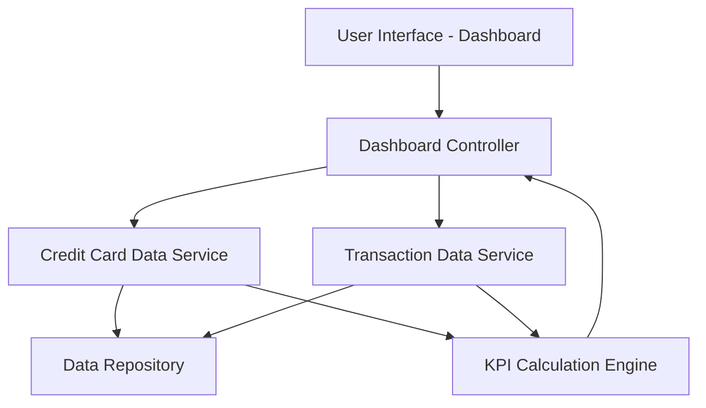

#### 1. High-Level Design

- **Summary:** This epic delivers a centralized, responsive dashboard that consolidates all user credit cards into a single view with key performance indicators (KPIs). Users can monitor monthly spend, total credit limit, available credit, and outstanding amounts across multiple cards, enabling quick assessment of overall credit health and financial position.

- **Component Flow:**

- **Integration Points:**
  - **Upstream:** Credit card data source (for card details, credit limits, balances)
  - **Upstream:** Transaction data service (for monthly spend calculations and outstanding amounts)
  - **Internal:** KPI calculation engine for aggregating and computing financial metrics

- **Key Assumptions:**
  - Credit card data is available via REST API or similar service interface with real-time or near-real-time synchronization.
  - KPI calculations (available credit, outstanding amounts) are computed on-demand or cached with acceptable refresh intervals.

- **NFR Highlights:** Responsive design across desktop, tablet, and mobile devices; optimized page load time for quick access; performant display of multiple credit cards without degradation.

#### 2. Validation Report

- **Requirements Coverage:** The design fully addresses the epic's scope including dashboard interface, all specified KPIs (monthly spend, total credit limit, available credit, outstanding amount), multi-card view, and responsive layout. Integration dependencies are identified and architectural components support the functional requirements. NFRs for responsiveness, performance, and multi-device support are explicitly incorporated into the design.