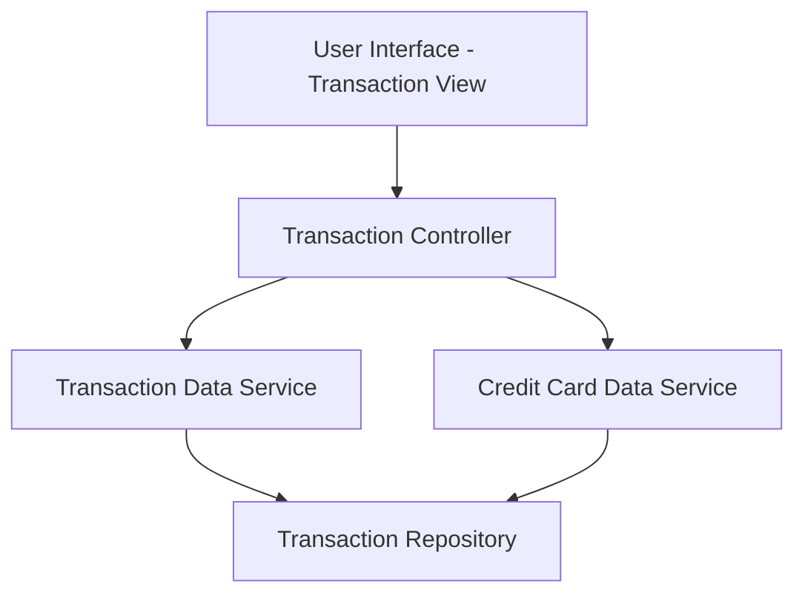

#### 1. High-Level Design

- **Summary:** This epic provides comprehensive transaction viewing and management capabilities across all user credit cards. Users can access detailed transaction histories, view individual transaction details, and monitor spending activities from a centralized interface, enabling complete visibility into card usage and spending behavior.

- **Component Flow:**

- **Integration Points:**
  - **Upstream:** Transaction data service or repository (for retrieving transaction records and history)
  - **Upstream:** Credit card data source (for associating transactions with specific cards)
  - **Internal:** Transaction filtering and aggregation logic for multi-card transaction views

- **Key Assumptions:**
  - Transaction data is stored in a structured repository with indexed fields for efficient querying and filtering by card, date, and other attributes.
  - Transaction history is retained for a defined period (e.g., 12-24 months) with pagination support for large datasets.

- **NFR Highlights:** Efficient handling and display of large transaction volumes; performant data retrieval even with extensive transaction history; smooth scrolling and navigation through transaction lists.

#### 2. Validation Report

- **Requirements Coverage:** The design comprehensively covers all stated scope items including transaction listing, transaction details view, multi-card aggregation, history access, and card-based filtering. Integration dependencies with transaction and credit card data services are clearly identified. NFRs for performance, scalability with large volumes, and smooth UI navigation are incorporated into the architectural approach.