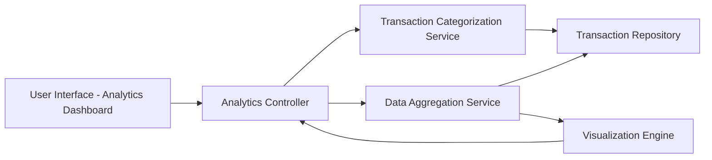

#### 1. High-Level Design

- **Summary:** This epic delivers interactive analytical capabilities with visual representations of spending patterns. Users can explore category-wise spending across nine predefined categories (Food & Dining, Fuel, Shopping, Travel, Entertainment, Utilities, Healthcare, Education, Miscellaneous), analyze monthly spend trends, and perform card-wise spend analysis to gain actionable insights into their financial behavior.

- **Component Flow:**

- **Integration Points:**
  - **Upstream:** Transaction categorization service or logic (for classifying transactions into nine predefined categories)
  - **Upstream:** Transaction data repository (for historical spending data)
  - **Internal:** Data aggregation service (for computing trends, category totals, and card-wise analytics)
  - **Frontend:** Visualization engine/library (for rendering interactive charts and graphs)

- **Key Assumptions:**
  - Transactions are automatically categorized using rule-based logic or ML classification; manual recategorization is out of scope.
  - Analytics data is aggregated periodically (e.g., nightly batch or near-real-time) and cached for performance optimization.

- **NFR Highlights:** Interactive and responsive visualizations; performant chart rendering with large datasets; real-time or near-real-time data aggregation for accurate analytics; accessible visualizations rendering correctly across all device types.

#### 2. Validation Report

- **Requirements Coverage:** The design fully addresses all scope elements including category-wise visualization, monthly trends, card-wise analysis, interactive charts, nine-category breakdown, and comparative analytics. All integration dependencies (categorization service, transaction repository, aggregation service) are identified and mapped to architectural components. NFRs for interactivity, performance with large datasets, real-time aggregation, and cross-device accessibility are explicitly incorporated into the design approach.