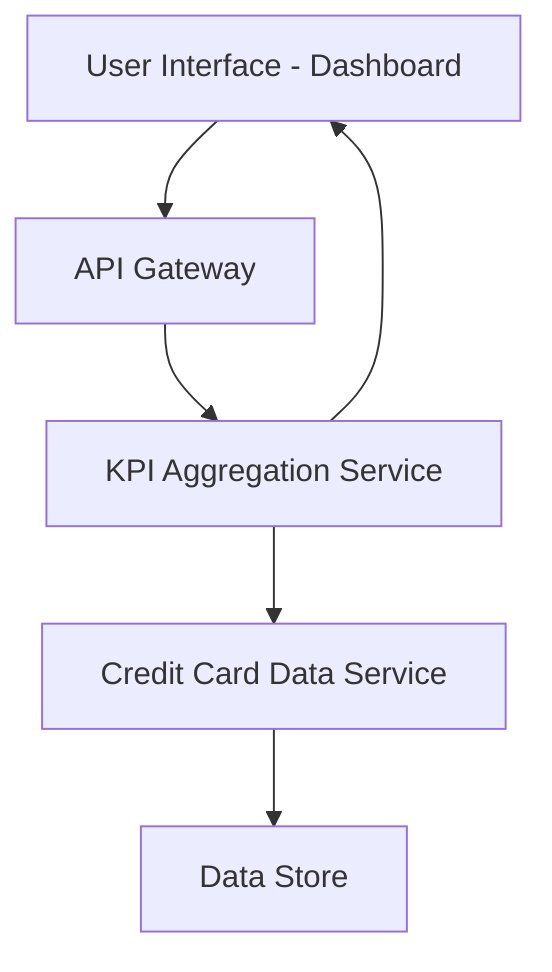

#### 1. High-Level Design

- **Summary:** This epic delivers a consolidated dashboard that displays key performance indicators (KPIs) for the user's credit card portfolio, including monthly spend, total credit limit, available credit, and outstanding amounts. The dashboard provides a centralized, responsive interface for monitoring overall credit card financial health across desktop, tablet, and mobile devices.

- **Component Flow:**

- **Integration Points:** 
  - Credit card data source or mock data service for retrieving card balances, limits, and transaction data
  - Backend API for KPI aggregation and calculation

- **Key Assumptions:** 
  - Data refresh frequency is assumed to be near real-time or on-demand via user action
  - KPI calculations (available credit, outstanding amounts) are performed server-side and returned as computed values

- **NFR Highlights:** Dashboard must support responsive layouts across desktop, tablet, and mobile devices; Page load time must be optimized for quick access to financial data; Data refresh must ensure accuracy of displayed metrics

#### 2. Validation Report

- **Requirements Coverage:** The design fully covers the epic's stated scope including dashboard KPI display, monthly spend tracking, total credit limit aggregation, available credit calculation, outstanding amount summary, and responsive layout design. The component flow demonstrates how data flows from the data store through services to the UI, satisfying the requirement for consolidated portfolio visibility. The responsive design requirement is addressed through the UI layer with multi-device support.