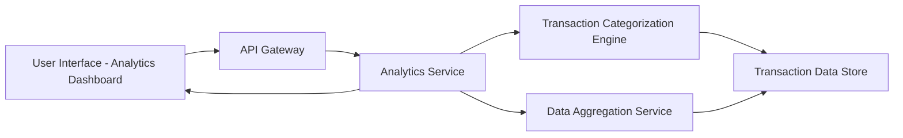

#### 1. High-Level Design

- **Summary:** This epic provides interactive visualizations and analytics to help users understand spending patterns through category-wise breakdowns and monthly spend trends. Users can explore transactions across predefined categories (Food & Dining, Fuel, Shopping, Travel, Entertainment, Utilities, Healthcare, Education, Miscellaneous) with trend analysis over time, enabling data-driven financial decisions.

- **Component Flow:**

- **Integration Points:** 
  - Transaction data service for retrieving categorized transaction history
  - Data aggregation service for computing trends and category summaries
  - Charting/visualization library (client-side) for rendering interactive charts and graphs

- **Key Assumptions:** 
  - Transaction categorization is pre-computed and stored, not performed in real-time during visualization
  - Monthly trend analysis covers a default time window (e.g., last 12 months) unless user specifies a custom date range

- **NFR Highlights:** Analytics visualizations must render efficiently with large transaction datasets; Interactive charts must respond to user interactions with minimal lag; Data aggregation for trends must be accurate and performant

#### 2. Validation Report

- **Requirements Coverage:** The design comprehensively covers all scope elements including category-wise spending visualization, monthly spend trend analysis, interactive charts and graphs, transaction categorization, spending pattern identification, and multi-category filtering and drill-down. The architecture separates concerns with dedicated services for categorization and aggregation, ensuring performance with large datasets as specified in NFRs. The interactive visualization component in the UI layer supports the requirement for user-driven exploration and drill-down capabilities.