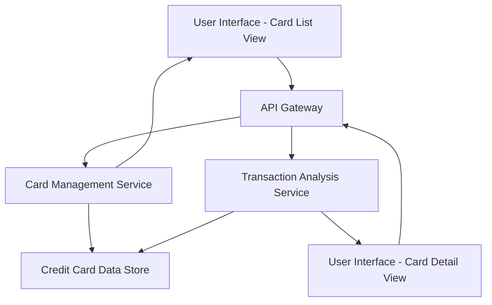

#### 1. High-Level Design

- **Summary:** This epic enables users to view, manage, and compare multiple credit cards within the dashboard. Users can see all cards with relevant details, switch between cards for card-specific information, and perform card-wise spend analysis. The feature supports portfolio-level comparison to help users optimize card usage across their credit card portfolio.

- **Component Flow:**

- **Integration Points:** 
  - Credit card data service for retrieving multiple card details and associated transaction histories
  - Transaction analysis service for card-wise spend analysis and comparison metrics

- **Key Assumptions:** 
  - Card switching is client-side navigation with server-side data fetch per card selection
  - Card display order is assumed to be based on default sorting (e.g., most recently used or alphabetical) unless user preferences are specified

- **NFR Highlights:** System must handle display and processing of multiple credit cards efficiently; UI must maintain performance with increasing number of cards; Card switching must be seamless with minimal latency

#### 2. Validation Report

- **Requirements Coverage:** The design addresses all scope elements including multiple credit card display, card-wise spend analysis, individual card detail views, card selection and navigation, and card-specific balance and limit information. The dual-view component flow (list view and detail view) supports the card switching and comparison requirements. The architecture ensures efficient handling of multiple cards through dedicated services for card management and transaction analysis, meeting the performance NFRs.