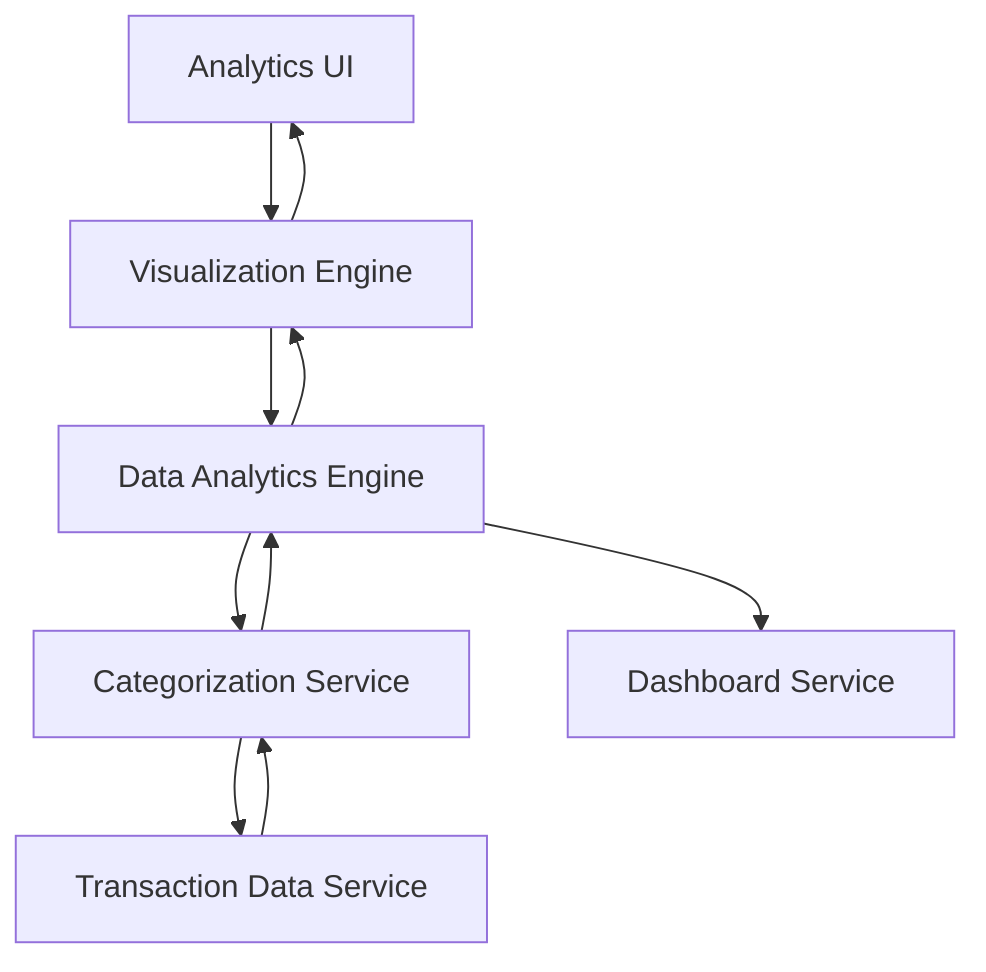

#### 1. High-Level Design

- **Summary:** This epic delivers comprehensive spending analytics with interactive visualizations showing category-wise spending breakdowns and monthly trends. Transactions are automatically categorized into 9 predefined categories (Food & Dining, Fuel, Shopping, Travel, Entertainment, Utilities, Healthcare, Education, Miscellaneous) to help users identify spending patterns and make informed budgeting decisions.

- **Component Flow:**

- **Integration Points:**
  - **Upstream:** Transaction Data Service (provides raw transaction data for analysis)
  - **Downstream:** Categorization Service (classifies transactions into predefined categories), Data Analytics Engine (processes and aggregates spending data), Dashboard Service (displays insights on main dashboard)

- **Key Assumptions:**
  - Transaction categorization uses rule-based or ML-based classification based on merchant names, MCC codes, or transaction descriptions.
  - Analytics data is pre-aggregated and cached for common queries (e.g., current month, last 3 months) to meet the 3-second rendering requirement.

- **NFR Highlights:** Analytics visualizations must render within 3 seconds; system must handle transaction history of at least 12 months; charts must be interactive and responsive across all device types.

#### 2. Validation Report

- **Requirements Coverage:** The design fully covers the epic's scope including category-wise spending visualization, monthly trend analysis, interactive charts, transaction categorization into 9 predefined categories, spending pattern identification, and time-based comparisons. The architecture supports the 3-second rendering requirement through pre-aggregation and caching strategies. The Categorization Service ensures accurate classification of transactions, while the Data Analytics Engine provides the computational power for trend analysis over 12 months of transaction history. The Visualization Engine ensures charts are interactive and responsive across all device types as specified in the NFRs.