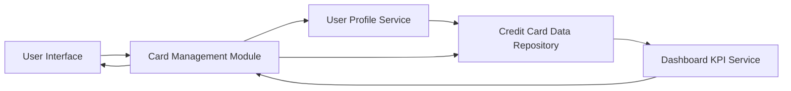

#### 1. High-Level Design

- **Summary:** This epic enables users to manage and view multiple credit cards (minimum 10 per user) with individual tracking of credit limits, available credit, outstanding balances, and card-wise spend analysis. Users can compare spending across cards and optimize credit utilization.

- **Component Flow:**

- **Integration Points:**
  - **Upstream:** User Profile Service (validates card ownership and user account)
  - **Downstream:** Credit Card Data Repository (stores and retrieves individual card details), Dashboard KPI Service (provides aggregated metrics for dashboard display)

- **Key Assumptions:**
  - Card data structure includes fields for card ID, credit limit, current balance, available credit, and transaction history.
  - Card-wise spend analysis aggregates transactions by card ID over a configurable time period (default: current month).

- **NFR Highlights:** System must support minimum 10 credit cards per user; card data retrieval must complete within 1 second; data consistency maintained across all card-related calculations.

#### 2. Validation Report

- **Requirements Coverage:** The design addresses all scope requirements including multiple card display, card-wise spend analysis, individual card details view, and card-specific tracking of credit limits, available credit, and outstanding balances. The architecture supports the 1-second retrieval requirement through optimized database queries and indexing on user ID and card ID. The User Profile Service ensures proper validation of card ownership, and the Dashboard KPI Service maintains data consistency across aggregated and individual card metrics.