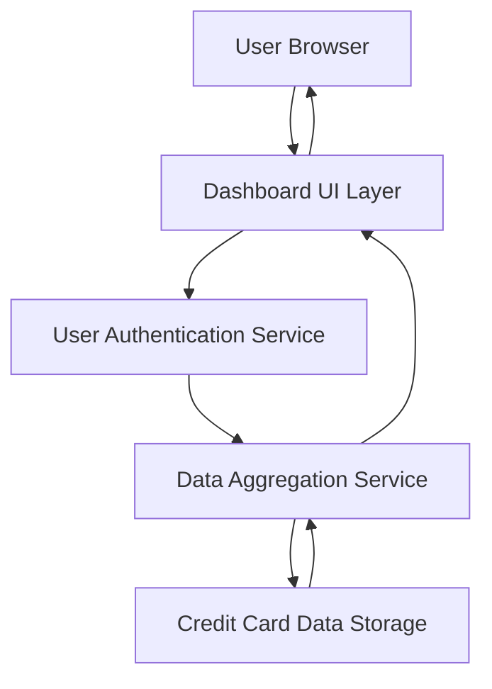

#### 1. High-Level Design

- **Summary:** This epic delivers a responsive dashboard providing users with a consolidated view of all credit cards and key performance indicators (monthly spend, total credit limit, available credit, outstanding amounts). It serves as the primary entry point for monitoring overall credit card portfolio health.

- **Component Flow:**

- **Integration Points:**
  - **Upstream:** User Authentication Service (validates user identity)
  - **Downstream:** Credit Card Data Storage Service (retrieves card data), Data Aggregation Service (calculates consolidated KPIs across multiple cards)

- **Key Assumptions:** 
  - Card data is refreshed in near real-time or at regular intervals (e.g., hourly) from the data storage service.
  - KPI calculations (total credit, available credit, outstanding amounts) are performed server-side by the aggregation service.

- **NFR Highlights:** Dashboard must load within 2 seconds under normal network conditions; responsive design across desktop, tablet, and mobile; WCAG 2.1 accessibility compliance.

#### 2. Validation Report

- **Requirements Coverage:** The design covers all stated scope elements including dashboard interface, KPI displays (monthly spend, credit limit, available credit, outstanding amount), multi-card consolidated view, and responsive layout. The architecture supports the 2-second load time requirement through efficient data aggregation and caching strategies. Authentication and data services are properly integrated to ensure secure access and accurate KPI calculations.