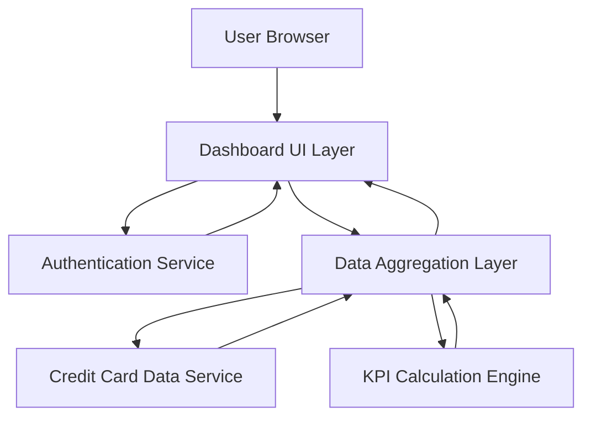

#### 1. High-Level Design

- **Summary:** This epic delivers a responsive dashboard that consolidates all user credit cards into a single unified interface, displaying key performance indicators including monthly spend, total credit limit, available credit, and outstanding amounts. The dashboard serves as the primary entry point for users to monitor their overall credit card portfolio health and financial status at a glance.

- **Component Flow:**

- **Integration Points:**
  - **Upstream:** User Authentication Service (for secure access and user identity verification)
  - **Upstream:** Credit Card Data Service (for retrieving card information, balances, and transaction data)
  - **Downstream:** Dashboard UI renders aggregated data to end users across multiple device types

- **Key Assumptions:**
  - Credit Card Data Service provides real-time or near-real-time data via REST/GraphQL API with JSON response format.
  - KPI calculations (total credit limit, available credit, outstanding amounts) are performed on the backend aggregation layer rather than client-side.

- **NFR Highlights:** Dashboard must be responsive across desktop, tablet, and mobile devices; Page load time must be under 2 seconds; Support real-time data refresh for KPIs.

#### 2. Validation Report

- **Requirements Coverage:** The design fully covers the epic's stated scope including dashboard interface development, KPI displays (monthly spend, total credit limit, available credit, outstanding amount), responsive layout implementation, and multiple credit card consolidated view. The architecture supports the required NFRs for responsiveness, load time, and real-time refresh through the data aggregation layer and separate UI/service layers.