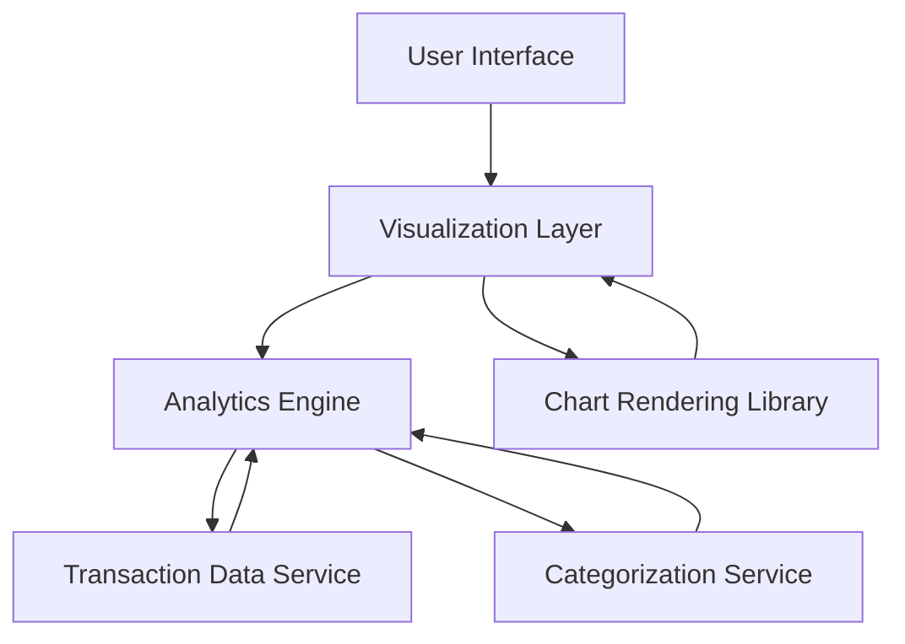

#### 1. High-Level Design

- **Summary:** This epic delivers comprehensive spending analytics with interactive visualizations that enable users to understand spending patterns through monthly trend analysis and category-based breakdowns across 9 predefined categories (Food & Dining, Fuel, Shopping, Travel, Entertainment, Utilities, Healthcare, Education, Miscellaneous). The analytics provide actionable insights for budget management and identification of savings opportunities over a 12-month historical period.

- **Component Flow:**

- **Integration Points:**
  - **Upstream:** Transaction Data Service (for retrieving categorized transaction history with at least 12 months of historical data)
  - **Upstream:** Analytics Engine (for processing, aggregating, and analyzing spending data across time periods and categories)
  - **External:** Chart Rendering Library Integration (for generating interactive, responsive visualizations compatible with desktop and mobile touch interactions)

- **Key Assumptions:**
  - Transactions are pre-categorized by the Transaction Data Service or Categorization Service using predefined category mappings; category assignment logic is maintained upstream.
  - Historical data for 12 months is readily accessible; analytics aggregations are computed server-side and cached to meet the 1.5-second rendering requirement.

- **NFR Highlights:** Analytics visualizations must render within 1.5 seconds; Support historical data analysis for at least 12 months; Interactive charts must be responsive and support touch interactions on mobile devices.

#### 2. Validation Report

- **Requirements Coverage:** The design comprehensively covers all scope elements including monthly spend trend visualization, category-wise spending analysis, interactive charts and graphs, spending pattern identification, multi-category support for all 9 specified categories, and transaction categorization display. The architecture supports the NFRs through a dedicated analytics engine for data processing, chart rendering library for responsive interactive visualizations, and appropriate separation of concerns to achieve the 1.5-second rendering target and 12-month historical data support.