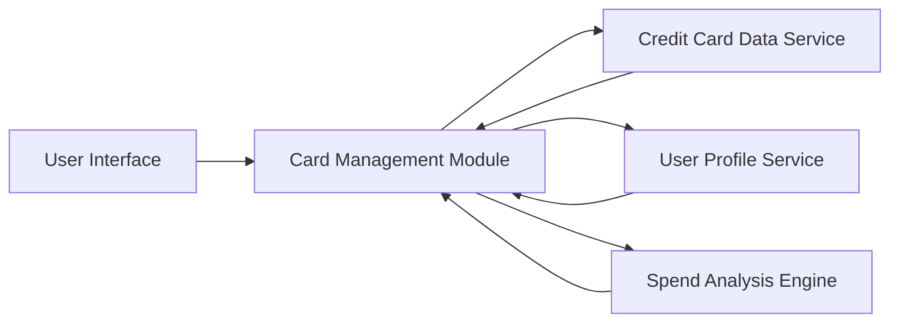

#### 1. High-Level Design

- **Summary:** This epic enables users to manage and track up to 10+ credit cards within the dashboard system, providing detailed card-level information including limits, balances, status, and card-wise spend analysis. Users can compare spending patterns across different cards to optimize credit utilization and manage their credit portfolio effectively.

- **Component Flow:**

- **Integration Points:**
  - **Upstream:** Credit Card Data Service (for retrieving card details, balances, status, and transaction data)
  - **Upstream:** User Profile Service (for associating credit cards with specific user accounts and managing user-card relationships)
  - **Internal:** Spend Analysis Engine (for processing card-wise spending patterns and comparison analytics)

- **Key Assumptions:**
  - Card data is retrieved via API calls with sub-300ms latency; card information is cached appropriately to meet performance requirements.
  - User-card associations are managed through unique identifiers; card data includes standardized fields for limits, balances, and status across all card types.

- **NFR Highlights:** System must support management of at least 10 credit cards per user; Card data retrieval latency must be under 300ms; Secure storage and display of card information.

#### 2. Validation Report

- **Requirements Coverage:** The design addresses all scope elements including multiple credit card display and management, individual card details view, card-wise spend analysis, card status tracking, card comparison capabilities, and credit card list management. The architecture supports the NFRs through dedicated services for card data retrieval (meeting the 300ms latency requirement), secure integration with user profile service, and a specialized spend analysis engine for card-level comparisons.