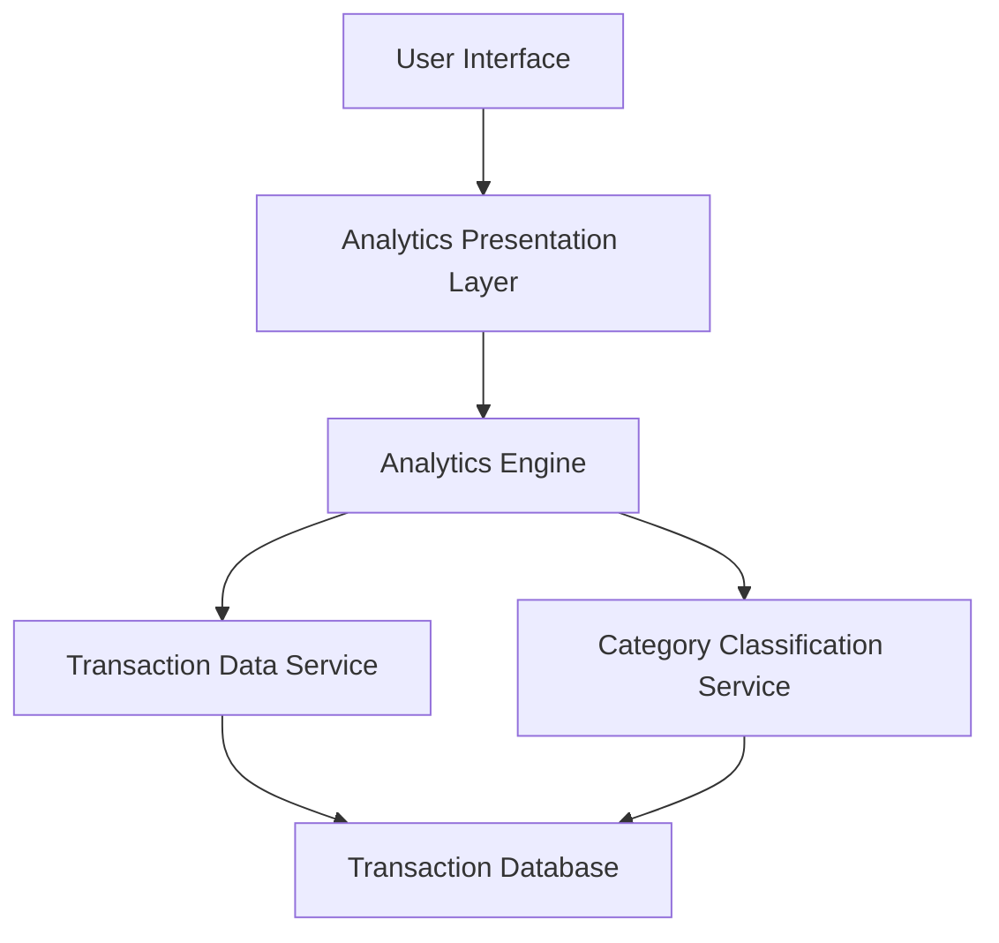

#### 1. High-Level Design

- **Summary:** This epic delivers interactive spending analytics with visualizations across 9 predefined categories (Food & Dining, Fuel, Shopping, Travel, Entertainment, Utilities, Healthcare, Education, Miscellaneous). Users can analyze monthly spend trends, card-wise spending, category breakdowns, and transaction history through interactive charts with drill-down capabilities.

- **Component Flow:**

- **Integration Points:**
  - **Upstream:** Transaction Data Service (for historical transaction records up to 1000+ transactions per card), Category Classification Service (for transaction categorization into 9 predefined categories)
  - **Downstream:** Analytics Engine aggregates and processes data for visualization rendering to the user interface

- **Key Assumptions:**
  - Transactions are pre-categorized by the category classification service using rule-based or ML-based classification; historical data retention period is sufficient to support trend analysis (period not specified).
  - Interactive drill-down operates on pre-aggregated data cached at multiple granularity levels to meet sub-second response time.

- **NFR Highlights:** Analytics visualizations must render within 3 seconds; system must handle minimum 1000 transactions per card; interactive charts must support drill-down capabilities with sub-second response time.

#### 2. Validation Report

- **Requirements Coverage:** The design comprehensively covers all requirements including monthly spend trend visualization, card-wise spend analysis, category-wise breakdown across 9 categories, interactive charts/graphs, transaction history view, and spending pattern identification. The architecture supports all NFRs through the analytics engine (3-second render time, 1000+ transactions per card handling) and optimized data aggregation for sub-second drill-down interactions.