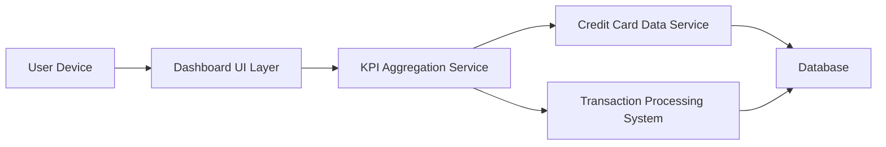

#### 1. High-Level Design

- **Summary:** This epic provides a consolidated financial dashboard displaying key performance indicators across all user credit cards, including monthly spend, total credit limit, available credit, and outstanding amounts. The dashboard offers a comprehensive snapshot of credit card portfolio health with responsive design for multi-device accessibility.

- **Component Flow:**

- **Integration Points:**
  - **Upstream:** Credit Card Data Service (for card details and balances), Transaction Processing System (for spending calculations and monthly spend aggregation)
  - **Downstream:** Dashboard UI serves aggregated data to user devices (mobile, tablet, desktop)

- **Key Assumptions:**
  - Monthly spend is calculated by aggregating transactions from the current calendar month; KPI calculations are performed server-side and cached for performance.
  - Real-time data refresh is triggered by user action or periodic polling (frequency not specified in epic).

- **NFR Highlights:** Dashboard must load within 2 seconds; system must support responsive design for mobile, tablet, and desktop; real-time data refresh capability required.

#### 2. Validation Report

- **Requirements Coverage:** The design addresses all core requirements including monthly spend display, credit limit aggregation, available credit calculation, outstanding amount tracking, and responsive multi-device layout. The architecture supports the 2-second load time NFR through KPI aggregation service and supports real-time refresh capability through integration with transaction processing system.