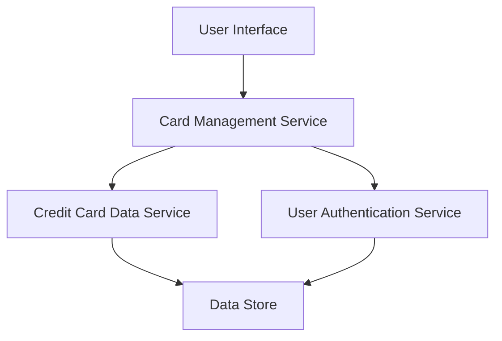

#### 1. High-Level Design

- **Summary:** This epic enables users to view and manage multiple credit cards (minimum 10 per user) within a unified interface. Users can access individual card details, monitor card-specific metrics (credit limits, available credit, outstanding balances), switch between cards seamlessly, and compare card performance across their portfolio.

- **Component Flow:**

- **Integration Points:**
  - **Upstream:** User Authentication Service (for secure card access and user identity verification)
  - **Downstream:** Credit Card Data Service (for retrieving card information, limits, balances, and availability data)

- **Key Assumptions:** 
  - Card data is retrieved via REST API calls with JSON format; card information is refreshed on-demand when user switches cards or views card details.
  - Card ownership validation is handled by the authentication service before displaying card data.

- **NFR Highlights:** System must support minimum 10 credit cards per user; card switching must occur within 500ms; data consistency across all card views must be maintained.

#### 2. Validation Report

- **Requirements Coverage:** The design covers all stated requirements including multiple card display, individual card detail views, card-wise tracking of credit limits/balances/available credit, and card comparison capabilities. The architecture supports the NFRs for card count (10+ cards), switching performance (500ms), and data consistency through centralized data service integration.