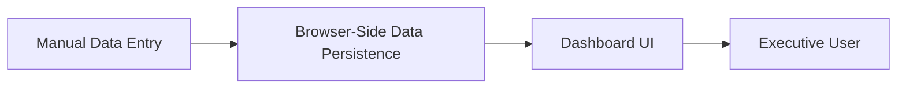

#### 1. High-Level Design
- Summary: This epic aims to create a high-level executive dashboard that provides a consolidated view of the Quality Engineering and Testing program's status. It focuses on presenting key performance indicators (KPIs) such as testing progress, agentification, and workflow completion in a simple, interactive, and visually clear manner for leadership.
- Component Flow:

- Integration Points: Upstream: Manual data input via a data editor; Downstream: None (The epic explicitly excludes integration with backend systems like ADO/Jira in the initial release).
- Key Assumptions: All necessary KPI data is available and will be entered manually. The dashboard is a standalone, client-side application running in a web browser.
- NFR Highlights: Dashboard load time must be ≤2 seconds, and it must be responsive for desktop, tablet, and presentation screens.
- Data Flow: Program data (e.g., testing progress, completion counts) is manually entered and saved in the browser's storage. The Dashboard UI reads this data to render the KPI summary tiles and visualizations for the end-user.
#### 2. Validation Report
- Requirements Coverage: The design fully covers the epic's scope, which is to create a non-integrated, client-side executive dashboard for visualizing manually entered testing KPIs.
