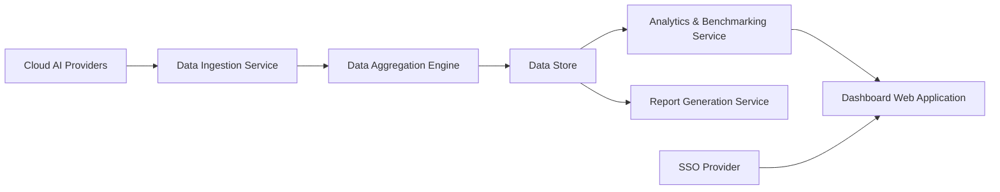

#### 1. High-Level Design

- **Summary**: This epic delivers a centralized, real-time dashboard that aggregates AI usage and spend data from AWS, Azure, and GCP across all portfolio companies. The core requirement is to provide portfolio-wide transparency through intuitive visualizations, benchmarking tools, drill-down analytics, and executive reporting capabilities that enable partners to monitor adoption, identify inefficiencies, detect anomalies, and track AI-driven value creation.

- **Component Flow**:

- **Integration Points**: 
  - Upstream: AWS, Azure, and GCP AI service APIs for usage and spend data collection
  - Upstream: Existing enterprise SSO provider for user authentication
  - Internal: Data freshness monitoring and performance monitoring services
  - Downstream: PDF and Excel export for board and investor meetings

- **Key Assumptions**: 
  - Portfolio companies have already enabled and configured cloud integrations with appropriate API access permissions
  - Industry benchmark data for AI adoption and spend comparison is available from external sources or pre-loaded reference datasets

- **NFR Highlights**: Dashboard pages shall load within 3 seconds for 95% of user interactions with up to 50 portfolio companies and 1,000 concurrent users; 99.5% uptime with automated failover; all data encrypted with TLS 1.2+ and AES-256; WCAG 2.1 AA accessibility compliance

- **Data Flow**: Cloud AI providers (AWS/Azure/GCP) expose usage and spend data → Data ingestion service collects data via secure APIs → Data aggregation engine consolidates and structures data across portfolio companies → Aggregated data stored in encrypted data store → Analytics & benchmarking service processes data for trends, anomalies, and comparisons → Dashboard web application (authenticated via SSO) presents real-time visualizations with drill-down capabilities → Report generation service produces PDF/Excel exports → Users access consolidated views at portfolio, company, department, or project level with data freshness indicators

#### 2. Validation Report

- **Requirements Coverage**: The design comprehensively covers all stated requirements including real-time consolidated dashboard, data aggregation from AWS/Azure/GCP, company-level and portfolio-level views with anomaly detection, benchmarking tools, drill-down analytics, data freshness indicators, executive summary views, report generation with pre/post-investment comparisons, and PDF/Excel export. The architecture explicitly addresses all NFRs: 3-second load time through optimized aggregation engine, support for 200 companies and 1,000 concurrent users via scalable services, encryption in transit (TLS 1.2+) and at rest (AES-256), role-based access control integrated with SSO, WCAG 2.1 AA accessibility in web application layer, and 99.5% uptime through automated failover. All dependencies are accounted for (cloud provider APIs, SSO integration, monitoring services) and out-of-scope items (direct AI model management, on-premise platforms, custom AI development) are respected by focusing solely on visibility and analytics.

---
