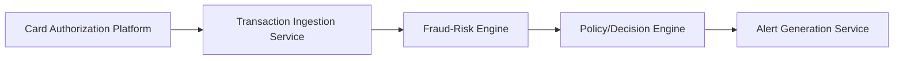

#### 1. High-Level Design
- Summary: This epic covers the foundational capabilities for ingesting and analyzing credit card transactions in real-time to identify suspicious activity. It includes integrating with a risk engine to score transactions and triggering alerts when a configurable risk threshold is met. The goal is to proactively detect potential fraud with high accuracy and speed.
- Component Flow:

- Integration Points: Upstream: Card authorization/transaction platform; Downstream: Fraud-risk engine/model, Policy/decision engine
- Key Assumptions: A fraud-risk engine/model is available for integration. The system can access transaction data from the authorization platform in real-time.
- NFR Highlights: Risk evaluation and alert triggering must meet a stringent transaction-time SLA. The system must be highly available and scalable to handle transaction spikes without delays.
- Data Flow: Transaction data is ingested from the card authorization platform, sent to the fraud-risk engine for scoring, and if the score exceeds a configured threshold, an alert record is generated.
#### 2. Validation Report
- Requirements Coverage: The design covers the core requirements of ingesting transactions, integrating with a risk engine, and generating alerts based on configurable thresholds.