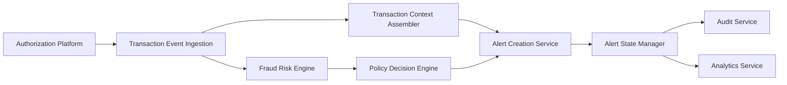

#### 1. High-Level Design

- **Summary**: This epic establishes end-to-end fraud evaluation for credit card transactions by ingesting transaction events, performing risk scoring via the fraud engine, applying configurable policy thresholds, and creating canonical fraud-alert records with transaction context. It ensures rapid detection of suspicious activity while minimizing false positives and maintaining a complete audit trail.

- **Component Flow**:

- **Integration Points**: 
  - **Upstream**: Card Authorization/Transaction Platform (publishes transaction events)
  - **Downstream**: Fraud-Risk Engine/Model (risk scoring), Policy/Decision Engine (threshold mapping), Alert Service (notification queuing), Analytics and Audit Services (lifecycle events and metrics), Monitoring Infrastructure (latency and performance dashboards)

- **Key Assumptions**: 
  - Transaction events contain sufficient context (amount, merchant, time, location, card ID) for risk evaluation
  - Fraud-risk engine provides risk scores with acceptable latency to meet transaction-time SLA

- **NFR Highlights**: Risk evaluation and alert triggering must meet agreed transaction-time SLA; high availability with disaster recovery for fraud decision services; strong authentication, authorization, encryption, and least-privilege access; idempotent processing with durable audit records; scalability to support transaction spikes

- **Data Flow**: Authorization Platform publishes transaction event → Transaction Event Ingestion receives and validates event → Fraud Risk Engine evaluates transaction and returns risk score → Transaction Context Assembler gathers merchant, amount, time, location, card details → Policy Decision Engine applies configurable thresholds and determines action (approve, alert, step-up, hold, decline) → Alert Creation Service generates canonical alert record if threshold exceeded → Alert State Manager transitions alert through lifecycle (created, queued) → Audit Service records decision and lifecycle transitions → Analytics Service captures fraud_alert_created events and risk decision metrics → Monitoring dashboards track fraud loss, detection rates, false positives, and response rates

#### 2. Validation Report

- **Requirements Coverage**: The design comprehensively covers transaction ingestion (FR-01), risk scoring integration (FR-02), configurable alert thresholds (FR-03), transaction context assembly (FR-05), alert state lifecycle management (FR-10 idempotency, states: created, queued, delivered, viewed, confirmed, reported, protected, resolved, expired), audit trail (FR-09), and fail-safe/fail-open handling when risk engine is unavailable. The architecture supports single transaction-to-alert mapping, duplicate event handling through idempotency, and analytics events for alert creation and risk decisions. NFRs for latency (transaction-time SLA), security (authentication, encryption, least privilege), availability (disaster recovery), reliability (idempotency, retries, durable audit), scalability (transaction spikes), privacy (data retention policies), and observability (metrics, logs, traces, dashboards) are addressed through component design choices and explicit service responsibilities.