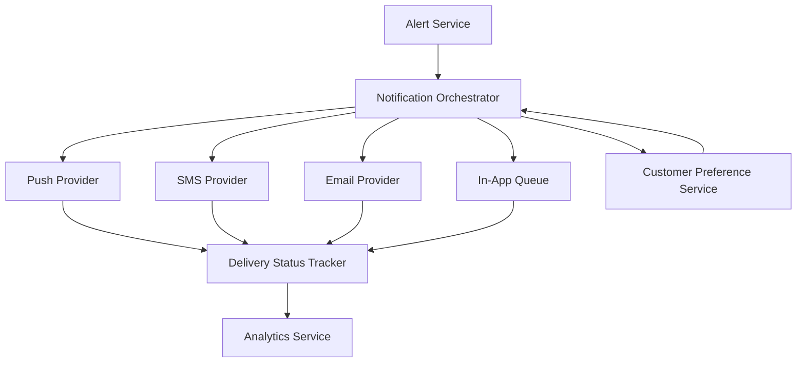

#### 1. High-Level Design

- **Summary**: This epic delivers timely fraud alerts to customers across multiple channels (push, SMS, email, in-app) with clear transaction context. It manages notification preferences, delivery status tracking, fallback mechanisms, and handles edge cases like provider failures, duplicate delivery, and offline customers to ensure customers receive actionable alerts without alert fatigue.

- **Component Flow**:

- **Integration Points**: 
  - **Upstream**: Alert Service (provides canonical alert records), Customer Identity/Authentication Service (for secure deep links), Policy/Decision Engine (determines alert triggers vs. interventions)
  - **Downstream**: Notification Providers (push, SMS, email, in-app), Analytics Infrastructure (delivery metrics), Monitoring Systems (latency and success rate tracking)

- **Key Assumptions**: 
  - Notification providers support retry mechanisms and provide delivery confirmation callbacks
  - Customer preference data is available synchronously or with acceptable latency for real-time alert decisions

- **NFR Highlights**: Near-real-time SLA from transaction event to alert delivery; high availability with disaster recovery for notification paths; security-critical alerts require secure links and deep-link protection; scalability to handle alert spikes without provider overload

- **Data Flow**: Alert Service creates canonical alert → Notification Orchestrator retrieves customer preferences and security overrides → Orchestrator selects appropriate channels (push, SMS, email, in-app) → Providers attempt delivery with retry/fallback logic → Delivery Status Tracker records outcomes (sent, delivered, failed) → Analytics Service captures fraud_alert_sent, fraud_alert_delivered, fraud_alert_failed events → Monitoring dashboards display per-channel performance and latency metrics

#### 2. Validation Report

- **Requirements Coverage**: The design addresses all core requirements including multi-channel delivery (FR-04), notification preferences with security overrides (FR-12), fallback mechanisms (FR-11), duplicate handling (FR-10), delivery status tracking (FR-09 audit trail), and alert content composition with transaction context (FR-05). The component flow supports grouped/prioritized alerts to prevent alert fatigue, offline customer handling via in-app queue, and comprehensive analytics events. NFRs for latency, availability, security, reliability, scalability, privacy, observability, and accessibility are explicitly covered through architectural choices (retry logic, fallback paths, secure deep links, provider redundancy, and monitoring infrastructure).