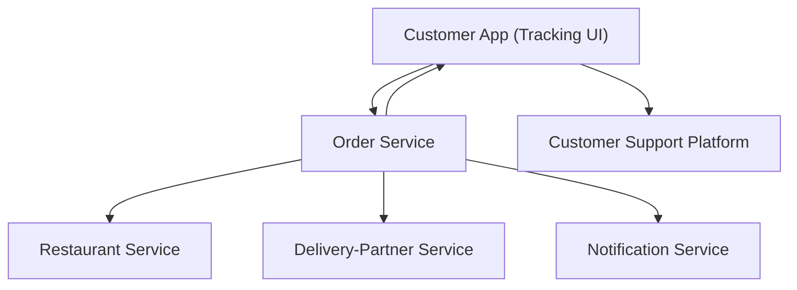

#### 1. High-Level Design
- Summary: Provide a real-time, customer-facing order tracking experience showing order status, stage timeline, and clear handling of delays, cancellations, and failures, with robust edge-case handling and contextual support entry points.

- Component Flow:

- Integration Points:
  - Order service as source of truth for order state and stage progression.
  - Restaurant service for acceptance, preparation, and ready-for-pickup events.
  - Delivery-partner service for assignment, pickup, and delivery-related status events.
  - Notification service for ETA change alerts, cancellation notifications, and critical exception messages.
  - Authentication/authorization services to ensure only permitted access to order data.
  - Analytics pipeline capturing tracking opens, ETA changes, exceptions, and support interactions.
  - Customer-support platform for contextual help triggered from tracking experience.

- Key Assumptions:
  - Order status and timeline events are delivered with consistent IDs and timestamps for safe sequencing.
  - Customer app retrieves active orders via authenticated APIs scoped to the user’s account/session.

- NFR Highlights:
  - Must support high-concurrency tracking with low-latency updates, secure account-scoped access, and robust handling of duplicate/out-of-order events while keeping the tracking screen usable quickly.

#### 2. Validation Report
- Requirements Coverage: The design covers real-time status display, timeline of fulfillment stages, exception/delay/cancellation handling, completion transition, persistence and recovery of active orders, failure-state messaging, support entry point, and edge cases such as pending acceptance, missing partner assignment, ETA increases, and duplicate/out-of-order events as specified in the epic’s scope and NFRs.
