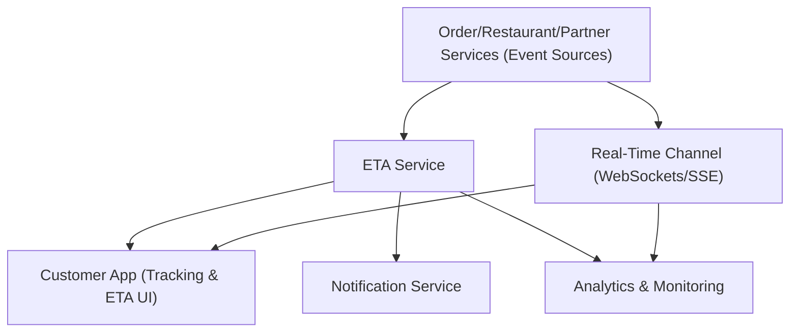

#### 1. High-Level Design
- Summary: Deliver accurate, continuously refreshed ETAs for active orders using a dedicated ETA service and real-time event pipeline, with safeguards for duplicate/out-of-order events, peak-traffic reliability, and clear communication of material ETA changes.

- Component Flow:

- Integration Points:
  - ETA service consuming order, restaurant, and delivery-partner signals for ETA computation.
  - Real-time infrastructure (WebSockets, SSE, or managed push) for status and ETA updates without full reload.
  - Order, restaurant, and delivery-partner services as the primary event sources for state and timing.
  - Notification service for push/SMS/email around material ETA changes and critical exceptions.
  - Analytics pipeline tracking ETA accuracy, update latency, and reliability KPIs.
  - Monitoring/logging systems for event pipeline health and peak-traffic behavior.

- Key Assumptions:
  - ETA service exposes versioned or timestamped updates to support a safe state machine for duplicate/out-of-order events.
  - Real-time channel gracefully falls back to periodic polling when connectivity or infrastructure is degraded.

- NFR Highlights:
  - Requires fast loading of core status and ETA, low-latency real-time updates, timestamp/version-based event processing, and scalable, highly available tracking under peak meal-period traffic while clearly communicating ETA as an estimate.

#### 2. Validation Report
- Requirements Coverage: The design addresses ETA calculation and display, live update mechanisms without full page reload, automatic refresh for active orders, communication of material ETA changes via in-app and notifications, graceful degradation on delayed/missing data, safe handling of duplicate/out-of-order events via a state machine, and performance/availability for high-volume tracking, aligning with the epic’s scope and NFR requirements.
