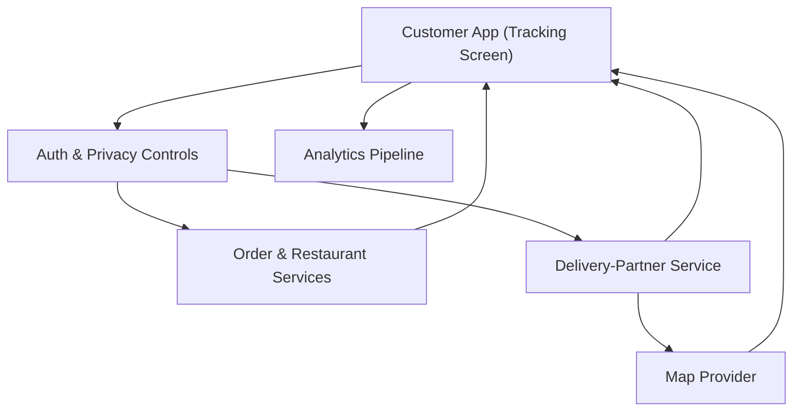

#### 1. High-Level Design
- Summary: Implement the visual tracking UI combining order status and ETA, stage timeline, restaurant and order summary, delivery-partner identity and approved contact options, and a live map after pickup, with strict rules around location accuracy, partner privacy, and accessibility.

- Component Flow:

- Integration Points:
  - Delivery-partner service for assignment, pickup, live location, and partner identity events.
  - Map provider for route and location rendering after pickup.
  - Order and restaurant services for order summary, status, and timeline content.
  - Authentication/authorization services for secure access to order and location data.
  - Privacy/compliance frameworks governing partner location retention and field exposure.
  - Analytics pipeline for map usage, tracking engagement, and partner-contact behavior.

- Key Assumptions:
  - Partner location events explicitly indicate availability state so the UI can switch between live map and non-location states without implying false positions.
  - Approved partner fields (e.g., name, photo, contact options) are centrally defined and enforced by the delivery-partner service or policy layer.

- NFR Highlights:
  - Map and partner data must not block core status/ETA usability, must never fake or imply location when unavailable, must comply with privacy and retention rules, expose only approved partner information, remain accessible to assistive technologies, and scale for concurrent map rendering during peak periods.

#### 2. Validation Report
- Requirements Coverage: The design satisfies the epic’s requirements for core tracking layout with prioritized status/ETA, visual timeline, restaurant and order summary display, delivery-partner identity and approved contact options, live map visualization after pickup with correct handling of unavailable location, arrival indication state, exception banners for delays/cancellations, and accessibility, while adhering to the defined NFRs around performance, privacy, and scalability.
