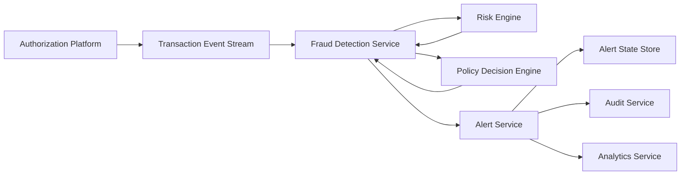

#### 1. High-Level Design

- **Summary:** This epic implements the core real-time fraud detection pipeline that ingests card transaction events, evaluates fraud risk using a risk engine, applies configurable alert thresholds and policies, and generates canonical fraud alert records. It establishes the alert state model and ensures reliable, idempotent processing with full audit trail and analytics instrumentation.

- **Component Flow:**

- **Integration Points:**
  - **Upstream:** Card Authorization/Transaction Platform publishes transaction events (transaction_id, account_id, card_id, merchant, amount, currency, timestamp, channel)
  - **Core:** Fraud Risk Engine/Model provides risk scores and risk bands; Policy/Decision Engine maps risk decisions to actions (approve, alert, step-up, hold, decline)
  - **Downstream:** Alert Service creates canonical alert records consumed by notification system (Epic QE-7363); Audit Service records alert lifecycle; Analytics Service captures fraud_alert_created events
  - **Supporting:** Monitoring infrastructure for latency and error tracking

- **Key Assumptions:**
  - Transaction events are published to a durable event stream (e.g., Kafka, Event Hub) with at-least-once delivery semantics
  - Risk Engine exposes a synchronous or near-synchronous API that returns risk scores within the transaction-time latency SLA

- **NFR Highlights:** Risk evaluation and alert triggering must meet agreed transaction-time latency SLA; high availability and disaster recovery for security-critical services; idempotency, retries, event versioning, and durable audit records for reliability; scalable to transaction spikes without unacceptable delays; observability via metrics, logs, traces, and dashboards

- **Data Flow:**
  1. **Input:** Transaction events from Authorization Platform containing transaction_id, account_id, card_id, merchant, amount, currency, timestamp, channel, and authorization status
  2. **Processing:** Fraud Detection Service consumes transaction event, performs idempotency check (duplicate transaction_id), invokes Risk Engine with transaction context to obtain risk_score and risk_band, passes risk decision to Policy Decision Engine which maps risk level to action (approve/alert/step-up/hold/decline)
  3. **Alert Generation:** If policy decision requires alert, Alert Service creates canonical fraud-alert record with alert_id, transaction_id, customer_id, severity, status='created', created_at, expires_at
  4. **State Management:** Alert state transitions from 'created' → 'queued' and is persisted in Alert State Store
  5. **Output:** Canonical alert record published to notification system; audit record written to Audit Service; analytics event (fraud_alert_created) emitted to Analytics Service with alert_id, transaction_id, risk_score, risk_band, decision, model_version, timestamp

#### 2. Validation Report

- **Requirements Coverage:** The design fully covers transaction ingestion (FR-01), risk scoring (FR-02), alert threshold evaluation (FR-03), canonical alert creation (FR-09), idempotent duplicate handling (FR-10), and audit trail (FR-09). The alert state model (created, queued, delivered, viewed, confirmed, reported, protected, resolved, expired) is architecturally supported through the Alert State Store. Business rules for single transaction to single alert mapping and configurable thresholds are addressed. The component flow aligns with the PRD's technical architecture (Section 14) and supports all required analytics events (Section 16). NFR requirements for latency, availability, security, reliability, scalability, and observability are explicitly designed into the service architecture.

---

